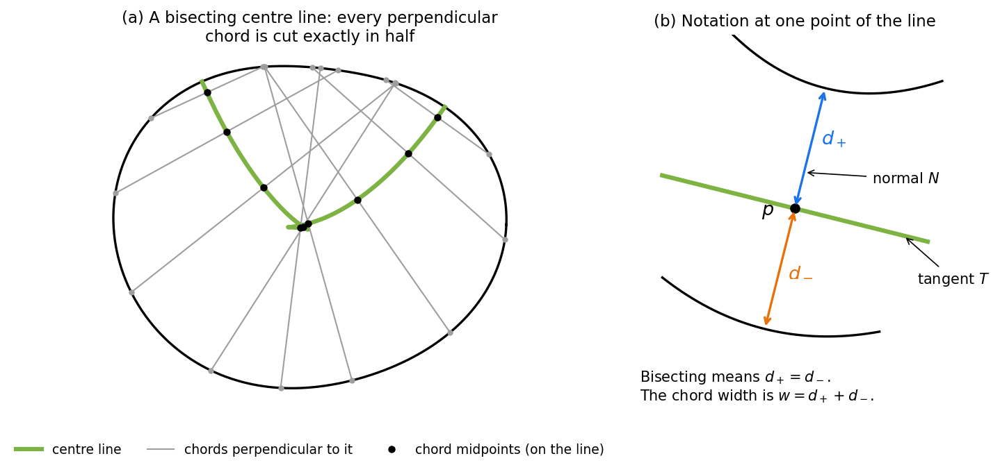
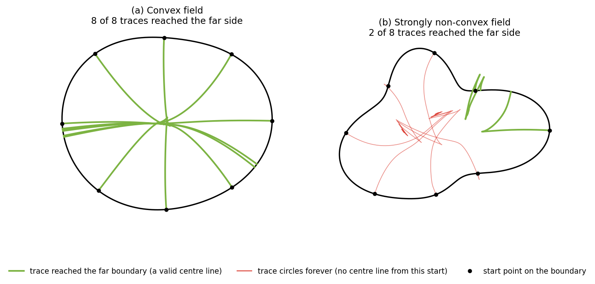
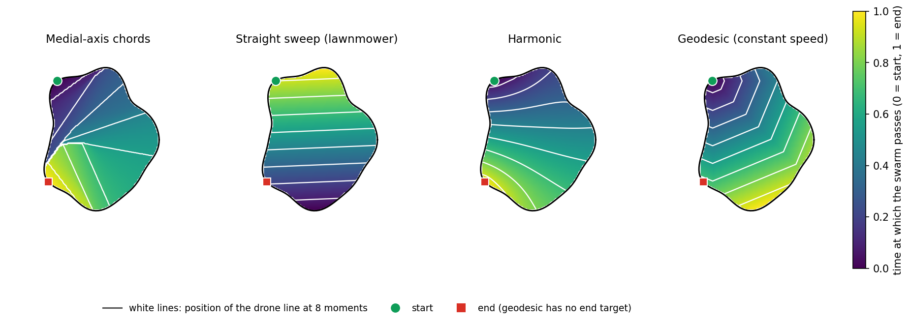
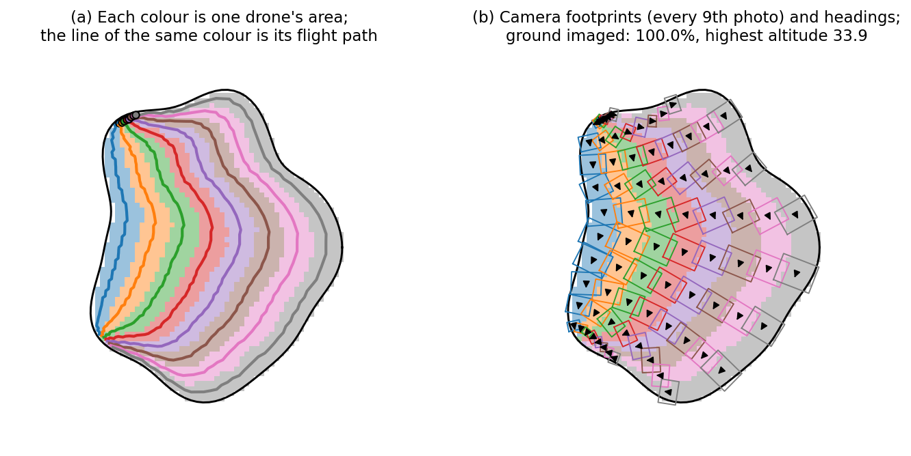

# Planning a Drone Swarm Sweep over a Field of Any Shape

**Team Asclepius, NIDAR Rescueswarm.** Technical report, October 2026.

Code: [`swarm_lab/`](../swarm_lab) · Interactive demo: <https://avinashistoocool.github.io/asclepius/> · Figures: [`figures.py`](figures.py) · Equation checks: [`verify_derivations.py`](verify_derivations.py) · Tables: [`results.py`](results.py)

---

## Summary

A line of drones flies over a field and photographs it with downward-pointing cameras. Each drone can fly higher to see a wider strip of ground. We want every point of the field photographed, using altitudes that are as low as possible.

We first tried to find one **centre line** through the field such that, wherever the drones are, the line cuts their row exactly in half. We wrote this as a calculus-of-variations problem (a *Lagrangian*), derived its equations, and found three things:

1. The equations simplify to a single direction field. Once the starting point on the boundary is chosen, the centre line is fixed.
2. In convex fields this always works.
3. In strongly non-convex fields it usually fails: the traced line circles forever and never reaches the other side. This is why our first solver kept reporting *"No validated numerical trajectory was found"*.

We therefore relaxed the problem. Instead of a single centre line, we describe the sweep by a **time map**: for every point of the field, the moment the drone line passes over it. We compare four time maps. One of them, the *harmonic* map, comes from minimising an energy and needed the lowest altitude on every field we tested. Finally, we split the field among the drones and set altitudes so that the whole field is photographed (100% coverage, guaranteed).

---

## 1. The problem

- **Field.** A region $\Omega$ in the plane bounded by a closed curve. In the code it is a polygon on a 600 × 600 canvas; all distances are in canvas units.
- **Swarm.** $N$ drones flying side by side as a flexible line. The line may bend, and it may split into groups to pass around an obstacle and rejoin later.
- **Camera.** Each drone has a downward (*nadir*) camera with horizontal and vertical fields of view HFOV and VFOV. At altitude $h$ it photographs a rectangle $2h\tan(\mathrm{HFOV}/2)$ wide and $2h\tan(\mathrm{VFOV}/2)$ long, centred under the drone and turned to its direction of travel.
- **Goal.** Every point of the field appears in at least one photo. Keep the highest altitude low, keep paths short, and give drones similar amounts of work.

This is a *coverage path planning* problem [Choset 2001; Galceran & Carreras 2013; Cabreira et al. 2019]. Most existing methods either sweep with straight back-and-forth passes [Choset & Pignon 1998] or divide the field into regions, one per robot [Cortés et al. 2004]. Our case differs because the drones fly together as a single line, and because each drone chooses its own altitude.

---

## 2. First idea: a centre line that cuts every chord in half

### 2.1 What we were looking for

Picture the drones as a straight row (a **chord** of the field) moving forward. If the row is always perpendicular to a smooth curve $p(s)$ and centred on it, then $p(s)$ is the path of the middle drone, and the row reaches equally far to both sides.



**Figure 1.** (a) A centre line (green) through a convex field. Each grey chord is perpendicular to the line, and its midpoint (black dot) lies on the line. (b) The quantities at one point: $T$ is the direction of the line, $N$ is the perpendicular direction, and $d_+$ and $d_-$ are the distances to the boundary on each side.

**Notation.** At a point $p$ on the line:

| Symbol | Meaning |
| --- | --- |
| $s$ | distance travelled along the line |
| $T$, $N$ | unit direction of the line and unit perpendicular |
| $\theta$ | angle of $N$ |
| $d_+$, $d_-$ | distance from $p$ to the boundary along $+N$ and $-N$ (the first wall hit) |
| $w = d_+ + d_-$ | chord width (the length of the drone row) |
| $e = \tfrac12(d_+ - d_-)$ | how far the chord's midpoint is from $p$ (zero when bisected) |
| $\kappa$ | curvature of the line: how fast $T$ turns per unit length |

**The requirement** is $e = 0$ everywhere along the line, i.e. $d_+ = d_-$.

### 2.2 Why this is the right requirement: the swept-area formula

As the row moves a short distance $\mathrm ds$ along the line, it sweeps a thin strip. A drone at signed offset $r$ from the centre travels $(1-\kappa r)\,\mathrm ds$, because drones on the inside of a bend move less. Adding up over the row:

$$
\frac{\mathrm dA}{\mathrm ds} = \int_{-d_-}^{d_+} (1-\kappa r)\,\mathrm dr = w\,(1 - \kappa e). \tag{1}
$$

- When $e = 0$, the swept area is exactly $\int w\,\mathrm ds$, with no correction for curvature. That is the reason for wanting a bisecting line.
- The row only moves forward everywhere if no drone travels backwards, i.e.
  $$\kappa\,d_+ < 1 \quad\text{and}\quad -\kappa\,d_- < 1. \tag{2}$$
  In words: in a bend, the inner end of the row must not pass the centre of the bend. If (2) fails, consecutive chords cross and the row **folds** over itself.

### 2.3 Writing it as a Lagrangian

To pick the *best* centre line, we minimise a cost $\int f\,\mathrm ds$ along it, where $f$ can depend on the position $p$ and the direction $\theta$. A natural choice is $f = w$, the chord width, which by (1) equals the swept area. In calculus-of-variations form, the Lagrangian is

$$
\mathcal L = f(p,\theta)\,|p'| . \tag{3}
$$

The factor $|p'|$ makes the cost independent of how fast we move along the line. The Euler–Lagrange equation of (3) [Gelfand & Fomin 1963] reduces to one equation for the curvature:

$$
\kappa\,\big(f + f_{\theta\theta}\big) = \partial_N f - \partial_T f_\theta. \tag{4}
$$

Here $f_\theta$ and $f_{\theta\theta}$ are derivatives with respect to the direction, and $\partial_N$, $\partial_T$ are derivatives along $N$ and $T$.

- If $f$ does not depend on direction, (4) becomes $\kappa f = \partial_N f$: the line bends towards cheaper regions, like light bending in glass.
- The term $f + f_{\theta\theta}$ is the line's *stiffness*. If it becomes negative, the equation has no smooth solution and the line develops corners. The same quantity appears in the theory of crystal shapes [Taylor 1978; Gurtin 1993].

Equation (4) needs the derivatives of the wall distances $d_\pm$. Moving $p$ or turning the chord changes where the chord hits the wall. If the wall's outward normal at the hit point is $\nu$, then

$$
\nabla_p d = -\frac{\nu}{\nu\cdot n}, \qquad \frac{\partial d}{\partial \alpha} = -\,d\,\frac{\nu\cdot n_\perp}{\nu\cdot n}, \tag{5}
$$

where $n$ is the chord direction, $\alpha$ its angle, and $n_\perp$ the chord direction turned by 90°. Both expressions blow up when $\nu\cdot n \to 0$, i.e. when the chord **grazes** the wall. In a non-convex field the chord then jumps to a different part of the wall, and $d$ jumps with it. This turns out to be the root of the trouble.

### 2.4 The requirement fixes the line almost completely

Adding the requirement $e=0$ with a Lagrange multiplier $\lambda(s)$ gives the constrained Lagrangian

$$
\mathcal L_\lambda = \big(f + \lambda\,e\big)\,|p'|. \tag{6}
$$

But look at the requirement itself. $e = 0$ involves only the position $p$ and the direction $\theta$, not how the direction changes. So **at every point, $e=0$ already tells us which way the line must go.** It defines a direction field, and the centre line must follow it. The only free choice left is the boundary point $c$ where the line starts. Minimising cost is therefore just a one-variable search:

$$
\min_{c\ \text{on the boundary}} \ \int_{\text{line starting at } c} f\,\mathrm ds. \tag{7}
$$

**Does a valid direction always exist?** Turning the chord by 180° swaps its two ends, so $e$ changes sign. Somewhere in between it must be zero (intermediate value theorem). So a bisecting direction exists at $p$ as long as $d_\pm$ change continuously as the chord turns. This is guaranteed in a convex field. In a non-convex field, the jumps from §2.3 can skip over zero (no valid direction) or cross it several times (several valid directions, so the line can branch).

### 2.5 Why our first solver failed

The first implementation (removed from the repository; see the git history) represented the line as a smooth spline and adjusted it by least squares until $e \approx 0$ at many sample points, with both ends pinned to the boundary. On most non-trivial fields it ended with messages like

```
Endpoint residual 0.007304; midpoint residual 3.6480.
```

meaning that the chord midpoints were still about 3.6 units off the line. The analysis above explains why:

1. **The equations are not smooth.** $d_\pm$ jump when the chord switches wall segments, but least squares assumes smooth equations.
2. **Too many conditions.** By §2.4 the line is fixed by its starting point. Pinning *both* ends as well is one condition too many, so in general there is no solution.
3. **The ends are degenerate.** At the boundary the chord shrinks to zero length, and the equations lose information there.
4. **Sometimes no line exists at all** (§2.4 and §3).

---

## 3. Tracing the centre line directly

### 3.1 Following the two chord ends instead of the midpoint

Instead of moving the midpoint and casting rays to the walls, we move the **two ends of the chord along the boundary**. Let the boundary be the curve $\gamma(u)$. Put one chord end at $a = \gamma(u)$ and the other at $b = \gamma(v)$. The midpoint is $m = (a+b)/2$ and the chord vector is $q = b - a$.

The chord must stay perpendicular to the path of its midpoint. Since $m' = \tfrac12(\gamma'(u)\,u' + \gamma'(v)\,v')$, this means

$$
q\cdot m' = 0 \quad\Longleftrightarrow\quad (q\cdot\gamma'(u))\,u' + (q\cdot\gamma'(v))\,v' = 0,
$$

so the two ends must move in the ratio

$$
(u',\ v') \ \propto\ \big(\,q\cdot\gamma'(v),\ \ -\,q\cdot\gamma'(u)\,\big). \tag{8}
$$

This is an ordinary differential equation for $(u,v)$. It needs no ray casting and stays smooth as long as the boundary is smooth. Similar "midpoint of two boundary points" constructions appear in shape analysis [Brady & Asada 1984; Leyton 1987].

**Starting the trace.** Both chord ends start at the same boundary point $c$, a chord of length zero. Equation (8) is degenerate there, because both components vanish. Writing $u = c - d$, $v = c + d$ and expanding for small $d$ gives

$$
c' \approx -\,d\,\big(\gamma'\cdot\gamma''\big), \qquad d' \approx |\gamma'|^2, \tag{9}
$$

which is perfectly regular. So **from every boundary point exactly one centre line starts**, and it leaves the boundary at a right angle. Starting from $c$ turns the problem into a simple step-by-step integration (an initial-value problem), as promised by (7).

**Chords where the line can stop.** The chord stops moving when both terms in (8) are zero: when it is perpendicular to the boundary at **both** ends. Every smooth convex field has at least two such chords: the longest chord (the diameter) and the chord across the narrowest width.

### 3.2 What happens in practice

We integrated (8)–(9) with a fourth-order Runge–Kutta method [Hairer et al. 1993] from 8 evenly spaced starting points on two smooth fields:



**Figure 2.** Centre lines traced from 8 starting points (black dots). (a) In a convex field, all 8 traces cross the field and end on the opposite boundary: each is a valid centre line. (b) In a strongly non-convex field, only 2 of the 8 reach the far side. The other 6 (red) keep circling inside the field, because the chord keeps rotating without ever closing.

**Conclusion.** Bisecting centre lines exist reliably only in convex or nearly convex fields. For general fields we need a different approach.

---

## 4. The practical approach: a time map

### 4.1 The idea

Let go of the single centre line. Instead, describe the sweep by a **time map** $T(x)$: for each point $x$ of the field, the moment ($0 \le T \le 1$) when the drone line passes over it. At time $t$, the drone line is the curve where $T(x) = t$, a *level line* of the map.

- Every point gets a time, so the whole field is swept by construction.
- If the level line breaks into several pieces, the swarm splits into groups.
- With $N$ drones spread evenly along a level line of length $\ell$, each drone covers a strip of width $\ell/N$. That width sets its altitude.

There is a neat link between the time map and the drone-line lengths, the coarea formula [Evans 2010]:

$$
\int_0^1 \big(\text{length of the drone line at time } t\big)\,\mathrm dt = \int_\Omega |\nabla T|\,\mathrm dx . \tag{10}
$$

So making $|\nabla T|$ small keeps the drone line short, and therefore keeps altitudes low. Each of our four planners is one choice of $T$.



**Figure 3.** The four time maps on the same field. Colour shows when the swarm passes each point (dark = early, yellow = late). The white lines show where the drone line is at 8 moments. Green circle: start; red square: end.

### 4.2 The four planners

**Medial-axis chords.** The *medial axis* is the set of centres of the largest circles that fit inside the field [Blum 1967]. We take its longest branch (the *trunk*) and sweep with the chord perpendicular to it. This is the closest relative of §2, but the medial axis is equally far from both walls, which is **not** the same as cutting the chord in half. The two agree only where the field is locally mirror-symmetric about the trunk. The average midpoint offset is 0.0 on an ellipse but 10 to 18 units on a star, a neck, or a random blob. The chords also fold where condition (2) fails.

**Straight sweep (lawnmower).** $T$ is the position along the field's longest direction (its principal axis), so the drone line is always straight. It is the continuous version of a back-and-forth survey [Choset & Pignon 1998]. Every drone moves at the same speed, but the line splits at every dent in the boundary.

**Harmonic.** $T = 0$ at the start and $T = 1$ at the end. In between, $T$ minimises the energy $\int_\Omega |\nabla T|^2$, which is the smoothest possible way to go from 0 to 1. The Euler–Lagrange equation of this energy is Laplace's equation:

$$
\Delta T = 0 . \tag{11}
$$

Because of the maximum principle, a harmonic map has no peaks or pits inside the field. As a result the drone line never closes into a loop and never folds back. Harmonic maps are already used for robot navigation [Connolly et al. 1990]. Minimising $\int|\nabla T|^p$ for other powers $p$ gives a family of related planners: $p \to 1$ minimises the total length (10), and $p \to \infty$ minimises the single longest drone line [Aronsson 1967].

**Geodesic (constant speed).** $T$ is the shortest walking distance from the start, going around obstacles. This is the minimal value of the Lagrangian $\int|\dot x|\,\mathrm dt$, and it satisfies the eikonal equation [Sethian 1999]

$$
|\nabla T| = \text{constant}, \tag{12}
$$

so the drone line advances at the same speed everywhere. Behind corners the line develops sharp kinks and splits. The kinks of the walking distance measured from the *whole* boundary trace out exactly the medial axis, which is the "grassfire" picture of the medial axis [Blum 1967; Kimia et al. 1995].

### 4.3 How each map is computed

The field is rasterised to a 200 × 200 grid.

- **Medial axis.** Sample the boundary every 1 unit and compute the Voronoi diagram of the samples. The Voronoi edges inside the field approximate the medial axis [Brandt & Algazi 1992]. Short side branches caused by small bumps are removed [Ogniewicz & Kübler 1995]. The longest remaining path is the trunk, and its two ends define the start and end of the sweep for all planners.
- **Harmonic.** Solve the standard 5-point discrete Laplace equation with a sparse direct solver [Virtanen et al. 2020].
- **Geodesic.** Shortest paths on the grid by fast marching [Sethian 1996], as implemented in scikit-image [van der Walt et al. 2014].
- **Drone-line positions.** The level lines $T = t$ at 90 moments, extracted by marching squares [Lorensen & Cline 1987].

---

## 5. From a time map to drones, paths and altitudes



**Figure 4.** The harmonic plan with 8 drones. (a) The field divided among the drones (colours), and each drone's flight path. (b) Camera footprints for every 9th photo, with heading arrows. The whole field is photographed.

### 5.1 Splitting the field among the drones

At each moment, measure the drone line from one end to the other, scaled from 0 to 1. Drone $i$ is responsible for the part between $i/N$ and $(i+1)/N$ and flies along its middle, at $(i + \tfrac12)/N$. Every point of the field is assigned to the drone whose part passed over it. This splits the whole field into $N$ areas, shown in Figure 4a. If the line has split into pieces, a drone may have to hop from one piece to another; we count these hops as *transit jumps*.

### 5.2 Choosing the altitudes

At each photo position we know where the drone is and which way it is heading. Every point of the drone's area must fall inside some photo. For a point at distance $\alpha$ ahead or behind and $\beta$ to the side of the nearest photo position, the drone must be at least

$$
h \ \ge\ \max\!\left(\frac{|\beta|}{\tan(\mathrm{HFOV}/2)},\ \frac{|\alpha| - \tfrac12(\text{distance between photos})}{\tan(\mathrm{VFOV}/2)}\right) \tag{13}
$$

high. We take the largest requirement at each photo position and add a 10% overlap margin.

### 5.3 Checking coverage, and fixing gaps

We then mark every grid cell that is actually inside a photo. Photos are placed densely between positions, using the lower of the two neighbouring altitudes so that the check is conservative. If any cell is missed, the drone responsible for it climbs a little near that spot, and we check again.

**Why this always succeeds.** Flying higher only makes footprints larger, so it can never un-photograph a point. Each correction therefore only adds coverage, and at a high enough altitude every footprint covers the whole field. In all our experiments every gap was closed within **two rounds**.

---

## 6. Results

Setup: 12 drones, HFOV 70°, VFOV 55°, 10% overlap. Fields: an ellipse, a five-pointed star, a C-shaped bend, a field with a narrow neck, and a random blob. All four planners photographed **100%** of every field. Altitudes are in canvas units; multiply by (field width in metres / 600) to get metres.

**Table 1. Highest altitude needed. Lower is better; bold is the best in each row.**

| Field | Medial-axis | Lawnmower | Harmonic | Geodesic |
| --- | ---: | ---: | ---: | ---: |
| Ellipse | 21.4 | **21.3** | **21.3** | 24.0 |
| Star | 140.7 | 58.4 | **31.0** | 77.0 |
| C-bend | 31.8 | 55.9 | **15.0** | 23.8 |
| Narrow neck | 93.5 | 84.1 | **21.1** | 159.2 |
| Blob | 27.9 | 28.1 | **24.9** | 79.1 |

**Table 2. Workload balance (smallest drone area ÷ largest drone area; 1 = perfectly equal). Last column: how often medial-axis chords fold over.**

| Field | Medial-axis | Lawnmower | Harmonic | Geodesic | Medial-axis folds |
| --- | ---: | ---: | ---: | ---: | ---: |
| Ellipse | **0.94** | 0.81 | 0.79 | 0.86 | 0% |
| Star | 0.12 | 0.80 | 0.41 | **0.81** | 23% |
| C-bend | 0.64 | **0.73** | 0.48 | **0.73** | 0% |
| Narrow neck | 0.16 | **0.85** | 0.32 | **0.85** | 42% |
| Blob | 0.16 | **0.87** | 0.39 | 0.84 | 52% |

**What the tables show:**

- **Harmonic needs the lowest altitude on every field.** It minimises an energy that penalises long, stretched drone lines (equation 10), and its line never folds. The drawback is uneven workload: the line bunches up in narrow parts and stretches in wide ones, so some drones cover much more ground than others.
- **Lawnmower and geodesic share the work most evenly,** because their lines move uniformly. But they split around dents, and the geodesic line needs a very high altitude where it kinks (159 at the neck).
- **Medial-axis chords only work well on simple, tube-like fields.** Elsewhere the chords fold (Table 2) and do not bisect.

**Recommendation:** use the harmonic plan when altitude is the main limit (camera resolution, regulations). Use lawnmower or geodesic when battery and workload balance matter more.

Computing all four plans takes 3 to 6 s in Python and 0.8 to 2.3 s in the browser demo.

---

## 7. Checking the mathematics

Every equation above is checked numerically by [`verify_derivations.py`](verify_derivations.py):

| What is checked | Equation | Error found |
| --- | --- | --- |
| Wall-distance derivative w.r.t. position, 200 random chords in an ellipse | (5) | $4\times10^{-8}$ |
| Wall-distance derivative w.r.t. chord angle | (5) | $8\times10^{-8}$ |
| The Euler–Lagrange equation splits as claimed (along-the-line part holds automatically) | (4) | $3\times10^{-9}$ |
| Traced chord stays perpendicular to its midpoint's motion | (8) | $8\times10^{-15}$ |
| Harmonic map satisfies the discrete Laplace equation | (11) | $3\times10^{-15}$ |
| Harmonic map has the lowest energy (small changes only raise it) | (11) | confirmed |
| Geodesic map moves at constant speed | (12) | confirmed |

The test suite [`swarm_lab/test_medial.py`](../swarm_lab/test_medial.py) also checks that every planner gives each drone an area and photographs 100% of the field.

---

## 8. How to take the equations further

1. **Find the best exact centre line where one exists.** Trace (8)–(9) from many starting points, keep the traces that reach the far side, and pick the start with the lowest cost (7). Check that each chord really hits the *nearest* wall, since in non-convex fields the traced chord can pass behind a bump. The chords that are perpendicular to the boundary at both ends (§3.1) are good places to start the search.
2. **Solve the curvature equation (4) as a boundary-value problem** when an optimal line is wanted without the exact bisection requirement. Suitable solvers include collocation [Kierzenka & Shampine 2001], available as `scipy.integrate.solve_bvp`, and multiple shooting [Ascher et al. 1995]. Start from an easy shape such as an ellipse and morph it gradually into the real field, re-solving at each step (numerical continuation [Allgower & Georg 2003]). Watch the stiffness $f + f_{\theta\theta}$: where it turns negative, the line will want a corner.
3. **Smooth out the wall jumps.** Replace "nearest wall" by a soft minimum over all walls, and sharpen it gradually. Alternatively, pose the whole problem as an optimisation with an interior-point solver [Wächter & Biegler 2006] through CasADi [Andersson et al. 2019]. Pontryagin's maximum principle [Pontryagin et al. 1962; Bryson & Ho 1975] gives the same equations as (6) and also handles drone turning limits.
4. **Minimise the worst altitude directly.** The harmonic map minimises an *average*. To minimise the *longest* drone line instead, minimise $\int|\nabla T|^p$ with increasing $p$ (§4.2) [Aronsson 1967; Chambers & Letscher 2009].
5. **Balance the harmonic plan's workload** by solving $\nabla\cdot(a(x)\nabla T)=0$ with a weight $a(x)$ chosen to even out the line's speed. This sits between the harmonic and geodesic planners.
6. **Find the exact minimum altitude.** Since higher altitude never reduces coverage (§5.3), the lowest uniform altitude scale that achieves full coverage can be found by bisection.
7. **Real flight.** Add turning and climb-rate limits, follow the terrain from an elevation model, and convert to GPS coordinates for the autopilot.

---

## 9. Limitations

- Exact bisecting centre lines exist only in convex or nearly convex fields (§3.2). The time-map approach is necessary, not just convenient.
- The medial axis is computed from boundary samples. How aggressively side branches are pruned affects the medial-axis planner, and the start and end points of all planners.
- Coverage is guaranteed on a 200 × 200 grid. Features smaller than one cell (3 units) are not resolved.
- Battery, wind, and flight dynamics are not modelled.
- The browser demo smooths the medial trunk differently from the Python version and uses grid Dijkstra instead of fast marching. Its numbers are close to the Python results, but not identical.

---

## 10. Reproducing this report

```powershell
py -m pip install -r swarm_lab/requirements.txt matplotlib
py paper/verify_derivations.py             # Section 7
py paper/figures.py                        # Figures 1-4
py paper/results.py                        # Tables 1-2
cd swarm_lab; py -m unittest test_medial   # coverage tests
```

---

## References

- Allgower, E. L., & Georg, K. (2003). *Introduction to Numerical Continuation Methods*. SIAM.
- Andersson, J. A. E., Gillis, J., Horn, G., Rawlings, J. B., & Diehl, M. (2019). CasADi: a software framework for nonlinear optimization and optimal control. *Mathematical Programming Computation*, 11(1), 1–36.
- Aronsson, G. (1967). Extension of functions satisfying Lipschitz conditions. *Arkiv för Matematik*, 6, 551–561.
- Ascher, U. M., Mattheij, R. M. M., & Russell, R. D. (1995). *Numerical Solution of Boundary Value Problems for Ordinary Differential Equations*. SIAM.
- Blum, H. (1967). A transformation for extracting new descriptors of shape. In W. Wathen-Dunn (Ed.), *Models for the Perception of Speech and Visual Form* (pp. 362–380). MIT Press.
- Brady, M., & Asada, H. (1984). Smoothed local symmetries and their implementation. *The International Journal of Robotics Research*, 3(3), 36–61.
- Brandt, J. W., & Algazi, V. R. (1992). Continuous skeleton computation by Voronoi diagram. *CVGIP: Image Understanding*, 55(3), 329–338.
- Bryson, A. E., & Ho, Y.-C. (1975). *Applied Optimal Control*. Hemisphere.
- Cabreira, T. M., Brisolara, L. B., & Ferreira Jr., P. R. (2019). Survey on coverage path planning with unmanned aerial vehicles. *Drones*, 3(1), 4.
- Chambers, E. W., & Letscher, D. (2009). On the height of a homotopy. *Proceedings of the 21st Canadian Conference on Computational Geometry*, 103–106.
- Choset, H. (2001). Coverage for robotics: a survey of recent results. *Annals of Mathematics and Artificial Intelligence*, 31, 113–126.
- Choset, H., & Pignon, P. (1998). Coverage path planning: the boustrophedon cellular decomposition. In *Field and Service Robotics* (pp. 203–209). Springer.
- Connolly, C. I., Burns, J. B., & Weiss, R. (1990). Path planning using Laplace's equation. *Proceedings of the IEEE International Conference on Robotics and Automation*, 2102–2106.
- Cortés, J., Martínez, S., Karataş, T., & Bullo, F. (2004). Coverage control for mobile sensing networks. *IEEE Transactions on Robotics and Automation*, 20(2), 243–255.
- Evans, L. C. (2010). *Partial Differential Equations* (2nd ed.). American Mathematical Society.
- Galceran, E., & Carreras, M. (2013). A survey on coverage path planning for robotics. *Robotics and Autonomous Systems*, 61(12), 1258–1276.
- Gelfand, I. M., & Fomin, S. V. (1963). *Calculus of Variations*. Prentice-Hall.
- Gurtin, M. E. (1993). *Thermomechanics of Evolving Phase Boundaries in the Plane*. Oxford University Press.
- Hairer, E., Nørsett, S. P., & Wanner, G. (1993). *Solving Ordinary Differential Equations I: Nonstiff Problems* (2nd ed.). Springer.
- Kierzenka, J., & Shampine, L. F. (2001). A BVP solver based on residual control and the MATLAB PSE. *ACM Transactions on Mathematical Software*, 27(3), 299–316.
- Kimia, B. B., Tannenbaum, A. R., & Zucker, S. W. (1995). Shapes, shocks, and deformations I. *International Journal of Computer Vision*, 15, 189–224.
- Leyton, M. (1987). Symmetry-curvature duality. *Computer Vision, Graphics, and Image Processing*, 38(3), 327–341.
- Lorensen, W. E., & Cline, H. E. (1987). Marching cubes: a high resolution 3D surface construction algorithm. *ACM SIGGRAPH Computer Graphics*, 21(4), 163–169.
- Ogniewicz, R. L., & Kübler, O. (1995). Hierarchic Voronoi skeletons. *Pattern Recognition*, 28(3), 343–359.
- Pontryagin, L. S., Boltyanskii, V. G., Gamkrelidze, R. V., & Mishchenko, E. F. (1962). *The Mathematical Theory of Optimal Processes*. Interscience.
- Sethian, J. A. (1996). A fast marching level set method for monotonically advancing fronts. *Proceedings of the National Academy of Sciences*, 93(4), 1591–1595.
- Sethian, J. A. (1999). *Level Set Methods and Fast Marching Methods* (2nd ed.). Cambridge University Press.
- Taylor, J. E. (1978). Crystalline variational problems. *Bulletin of the American Mathematical Society*, 84(4), 568–588.
- van der Walt, S., et al. (2014). scikit-image: image processing in Python. *PeerJ*, 2, e453.
- Virtanen, P., et al. (2020). SciPy 1.0: fundamental algorithms for scientific computing in Python. *Nature Methods*, 17, 261–272.
- Wächter, A., & Biegler, L. T. (2006). On the implementation of an interior-point filter line-search algorithm for large-scale nonlinear programming. *Mathematical Programming*, 106(1), 25–57.
