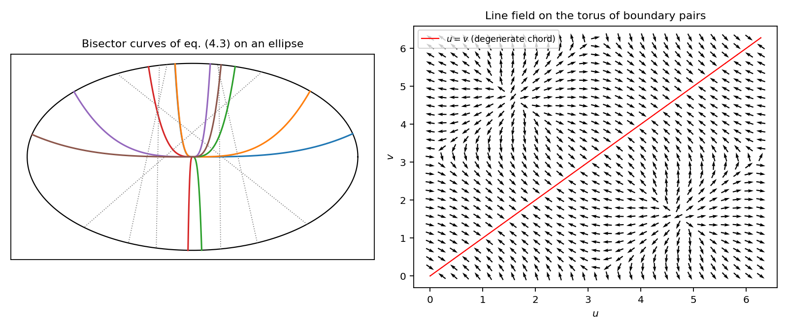
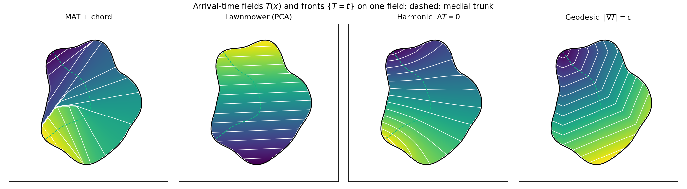

# Variational Sweep Planning for Nadir-Camera Drone Swarms over Arbitrary Planar Fields

**Team Asclepius, NIDAR Rescueswarm**
Technical report, October 2026. Code: [`swarm_lab/`](../swarm_lab), interactive demo: <https://avinashistoocool.github.io/asclepius/>, derivation checks: [`verify_derivations.py`](verify_derivations.py)

---

## Abstract

We study how a swarm of $N$ drones flying as a flexible line, each carrying a downward-facing (nadir) camera at an adjustable altitude, can image every point of a planar field of arbitrary shape. The problem starts from a classical idea: a single smooth path whose perpendicular chord is bisected at every point. We give this path a variational formulation with a Lagrangian, derive its Euler–Lagrange equations and the derivatives of the ray-hit distances they depend on, and prove a *swept-area identity*. The identity shows why chord bisection is the natural constraint: on a bisecting path, the integrated chord width equals the swept area exactly. We show that the bisection constraint reduces to a first-order line field, prove that the field exists in convex fields, and give a desingularised boundary-pair ODE whose equilibria are the double normals of the boundary. We also explain why direct numerical solution of the full problem is fragile. Next, we relax the single-path problem to *arrival-time fields* $T(x)$, whose level sets are the swarm formation. Four instances are compared: medial-axis chord time, principal-axis projection, the harmonic minimiser of the Dirichlet energy, and the eikonal (geodesic) solution. A lane partition assigns ground to drones, and a monotone altitude repair guarantees 100% nadir coverage. Every derivation is checked numerically, and we close with a concrete roadmap for solving the remaining equations.

---

## 1. Introduction

Coverage path planning asks for a motion that brings a sensor footprint over every point of a region [Choset 2001; Galceran & Carreras 2013; Cabreira et al. 2019]. Classical single-robot planners decompose the region into cells and sweep each one boustrophedon-style [Choset & Pignon 1998]. Multi-robot formulations instead partition the region, for example by Voronoi-based coverage control [Cortés et al. 2004]. Our setting differs in three ways:

1. **Line formation.** The swarm moves as a single flexible line (a *front*), which may split around obstacles and rejoin.
2. **Adjustable swath.** Each drone sets its own altitude $h$, so its ground footprint scales linearly with $h$.
3. **Nadir imaging.** Coverage means *imaged by at least one downward camera*, not just *passed over by the front*.

The starting point was a geometric question. Is there a smooth trajectory through the field that **bisects every chord perpendicular to it**? A rigid line of drones centred on that trajectory would then sweep the field symmetrically. Sections 3 and 4 develop this idea rigorously. Section 5 explains why it must be relaxed, and Sections 6 to 8 describe and evaluate the planner that was built.

### 1.1 Contributions

- A Lagrangian formulation of the bisecting-trajectory problem, with closed-form ray-hit derivatives (3.4)–(3.5) and the Euler–Lagrange equations (3.9)–(3.10) for any Lagrangian of the form $f(p,\theta)\,|p'|$.
- The **swept-area identity** (3.11), $\mathrm{d}A/\mathrm{d}s = w\,(1-\kappa e)$, and the no-fold condition (3.12).
- An existence result for the bisecting line field in convex fields (Proposition 1), and a **desingularised boundary-pair ODE** (4.4) that turns the endpoint boundary-value problem into an initial-value problem.
- A unified *arrival-time* relaxation that covers medial-axis, PCA, harmonic ($p=2$ Laplacian) and eikonal sweeps, linked to the original problem by the coarea formula.
- A lane-partition allocation and a monotone altitude repair with a coverage guarantee (Proposition 2).
- Reproducible numerical checks of every derivation (Table 2), and an open-source browser implementation.

---

## 2. Problem statement and notation

Let $\Omega\subset\mathbb{R}^2$ be a bounded, simply connected field with piecewise-smooth boundary $\partial\Omega$. In code it is a simple polygon on a $600\times600$ canvas. All lengths below are in canvas units.

| Symbol | Meaning |
| --- | --- |
| $p(s)$ | candidate trajectory, arc length $s$ |
| $T = p'$, $N = JT$ | unit tangent and unit normal, where $J$ is rotation by $+\pi/2$ |
| $\theta$ | angle of $N$, so $N = (\cos\theta,\sin\theta)$ and $\mathrm{d}N/\mathrm{d}\theta = JN = -T$ |
| $\kappa$ | signed curvature: $T' = \kappa N$, $N' = -\kappa T$ (Frenet; do Carmo 1976) |
| $d_\pm(p,\theta)$ | distance from $p$ to the first boundary hit along $\pm N$ |
| $x_\pm = p \pm d_\pm N$ | the two chord endpoints |
| $\nu_\pm$ | outward unit boundary normal at $x_\pm$ |
| $w = d_+ + d_-$ | chord width |
| $e = (d_+ - d_-)/2$ | chord-midpoint offset (the *bisection error*) |
| $T(x)$ | arrival time of the sweep front (Section 5); no clash with $T$ the tangent in context |
| $\gamma(u)$ | boundary parametrisation for the pair formulation (Section 4) |

**Problem A (bisecting trajectory).** Find a smooth curve $p:[0,L]\to\overline\Omega$ with endpoints on $\partial\Omega$ such that $e(p(s),\theta(s)) = 0$ for all $s$, optionally minimising a cost $\int_0^L f\,\mathrm{d}s$.

**Problem B (swarm coverage).** Given $N$ drones with camera fields of view $(\mathrm{HFOV},\mathrm{VFOV})$, find flight paths, headings and altitudes $h_i(t)$ such that every point of $\Omega$ lies inside at least one nadir footprint, while keeping $\max h$, mission length and workload imbalance small.

---

## 3. Variational formulation of the bisecting trajectory

### 3.1 First-hit distances

$$
d_\pm(p,\theta) = \min\{\, r>0 : p \pm rN(\theta) \in \partial\Omega \,\}, \qquad
w = d_+ + d_-, \qquad e = \tfrac12 (d_+ - d_-). \tag{3.1–3.3}
$$

Using *first* hits keeps the chord inside the connected piece of $\Omega$ that contains $p$, which matters when the field is not convex.

### 3.2 Derivatives of the ray-hit distance

Let $\phi$ be a local defining function of $\partial\Omega$ near a transversal hit point $x = p + d\,n$ (unit direction $n$, outward normal $\nu = \nabla\phi/|\nabla\phi|$, $\nu\cdot n\neq0$). Differentiating $\phi(p + d\,n)=0$ gives $\nu\cdot(\delta p + \delta d\,n + d\,\delta n)=0$, hence

$$
\nabla_p d = -\frac{\nu}{\nu\cdot n}, \tag{3.4}
$$

$$
\frac{\partial d}{\partial \alpha} = -\,d\,\frac{\nu\cdot Jn}{\nu\cdot n} \qquad (\text{rotating } n \text{ by angle } \alpha). \tag{3.5}
$$

Write the incidence slopes $\tau_+ = \dfrac{\nu_+\cdot T}{\nu_+\cdot N}$ and $\tau_- = \dfrac{\nu_-\cdot T}{-\nu_-\cdot N}$. These are signed tangents of the angle between the chord and the boundary normal. Applying (3.4)–(3.5) to both ends gives

$$
\nabla_p d_+ = -N - \tau_+ T,\quad \nabla_p d_- = N - \tau_- T,\quad
\partial_\theta d_+ = d_+\tau_+,\quad \partial_\theta d_- = -d_-\tau_-,
$$

$$
\nabla_p w = -(\tau_+ + \tau_-)\,T,\qquad
\nabla_p e = -N - \tfrac12(\tau_+ - \tau_-)\,T,\qquad
\partial_\theta e = \tfrac12 (d_+\tau_+ + d_-\tau_-). \tag{3.6–3.7}
$$

Two sanity checks follow. Sliding $p$ along its own chord leaves $w$ unchanged ($\partial_N w = 0$) and lowers $e$ at unit rate ($\partial_N e = -1$). And if the boundary is locally mirror-symmetric about the trajectory, then $\tau_+ = \tau_-$, so $\partial_T e = 0$ and a zero offset stays zero.

> **Singularity.** (3.4)–(3.5) blow up when $\nu\cdot n\to0$, that is, when the chord grazes the boundary. In a non-convex field the first-hit distance then **jumps** as the chord switches to a different boundary piece. This is the main obstruction to direct numerical solution (Section 3.6).

### 3.3 Euler–Lagrange equations for $L = f(p,\theta)\,|p'|$

Consider a general reparametrisation-invariant Lagrangian $\mathcal{L}(p,p') = f\big(p, N(p')\big)\,|p'|$ with $N = Jp'/|p'|$ [Gelfand & Fomin 1963]. Using $\partial N/\partial p' = J(I - TT^{\!\top})/|p'|$ and $J^{\!\top}=-J$,

$$
\frac{\partial\mathcal L}{\partial p} = |p'|\,\nabla_p f, \qquad
\frac{\partial\mathcal L}{\partial p'} = f\,T - (T\cdot\nabla_N f)\,N = f\,T + f_\theta\,N. \tag{3.8}
$$

Substituting into $\frac{\mathrm d}{\mathrm ds}\frac{\partial\mathcal L}{\partial p'} = \frac{\partial\mathcal L}{\partial p}$ and using the Frenet relations, the equation splits into two components.

*Tangential component.* It holds **identically**, which is the Noether identity for reparametrisation invariance:

$$
\frac{\mathrm d f}{\mathrm ds} + \kappa\,(T\cdot\nabla_N f) = T\cdot\nabla_p f. \tag{3.9}
$$

*Normal component.* It is the curvature equation:

$$
\boxed{\;\kappa\,\big(f + f_{\theta\theta}\big) = \partial_N f - \partial_T f_\theta\;} \tag{3.10}
$$

where $\partial_N = N\cdot\nabla_p$ and $\partial_T = T\cdot\nabla_p$. For isotropic costs ($f_\theta = 0$) this reduces to the weighted-geodesic (Snell) law $\kappa f = \partial_N f$. The factor $f + f_{\theta\theta}$ is the anisotropic *stiffness* known from crystalline and phase-boundary problems [Taylor 1978; Gurtin 1993]. The equation is elliptic, giving well-posed shooting, only where $f + f_{\theta\theta} > 0$.

For the **width cost** $f = w$ we have $\partial_N w = 0$, so (3.10) becomes $\kappa\,(w + w_{\theta\theta}) = -\partial_T w_\theta$. The derivatives $w_\theta$ and $w_{\theta\theta}$ follow from (3.6) and contain the boundary curvatures at $x_\pm$ through $\partial_\theta\nu_\pm$.

### 3.4 Why bisection: the swept-area identity

Parametrise the region swept by the chord as $x(s,r) = p(s) + r\,N(s)$ with $r\in[-d_-, d_+]$. Since $N' = -\kappa T$, we get $\partial_s x = (1-\kappa r)\,T$ and $\partial_r x = N$, so the Jacobian is $|1-\kappa r|$. Wherever the chord does not fold,

$$
\frac{\mathrm dA}{\mathrm ds} = \int_{-d_-}^{d_+} (1-\kappa r)\,\mathrm dr = w - \frac{\kappa}{2}\,(d_+^2 - d_-^2) = w\,(1-\kappa\,e). \tag{3.11}
$$

**Consequence.** On a bisecting trajectory ($e\equiv0$), $\int w\,\mathrm ds$ is *exactly* the swept area. The bisection constraint is precisely the condition under which the line integral of chord width measures coverage. The chord sweeps without folding if and only if

$$
\kappa\,d_+ < 1 \quad\text{and}\quad -\kappa\,d_- < 1, \tag{3.12}
$$

that is, neither chord endpoint passes the centre of curvature. A drone at offset $r$ moves with speed $|1-\kappa r|$ relative to the centre, so (3.12) also bounds the speed spread across the formation. Section 7 measures folds of the medial-axis chord field, which violate (3.12).

### 3.5 The constrained problem and its reduction to a line field

The natural constrained problem is: minimise $\int f\,\mathrm ds$ subject to $e(p,\theta)=0$. Its Lagrangian is

$$
\mathcal L_\lambda = \big(f + \lambda(s)\,e\big)\,|p'|, \tag{3.13}
$$

and its Euler–Lagrange equations are (3.10) with $f\mapsto f+\lambda e$, together with $e=0$. The constraint is in fact much stronger. $e(p,\theta)=0$ involves no derivative of $\theta$, so at each point it fixes the normal direction algebraically: **bisecting trajectories are the integral curves of the line field $\theta^\star(p)$ defined by $e(p,\theta^\star)=0$.** The only remaining freedom is the starting point on $\partial\Omega$, a single parameter. Problem A therefore reduces to a **one-dimensional search** over the starting point $c$ of the integral curve $\Gamma_c$:

$$
\min_{c\in\partial\Omega} J(c) = \int_{\Gamma_c} f\,\mathrm ds, \tag{3.14}
$$

and the multiplier $\lambda$ in (3.13) is the adjoint of the sensitivity $\partial\Gamma_c/\partial c$.

**Proposition 1 (existence of a bisecting direction).** Let $p\in\Omega$, and suppose the first-hit distances are continuous in $\theta$ at $p$. This holds, for example, if $\Omega$ is convex or strictly star-shaped with respect to $p$. Then there exists $\theta^\star\in[0,\pi)$ with $e(p,\theta^\star)=0$. If additionally $\partial_\theta e(p,\theta^\star)\neq0$, i.e. $d_+\tau_+ + d_-\tau_- \neq 0$ by (3.7), then $\theta^\star$ is locally a $C^1$ function of $p$, and the integral curve through $p$ is locally unique.

*Proof.* Rotating by $\pi$ swaps the two rays, so $d_\pm(p,\theta+\pi) = d_\mp(p,\theta)$ and hence $e(p,\theta+\pi) = -e(p,\theta)$. A continuous function that changes sign over $[\theta_0,\theta_0+\pi]$ has a root there (intermediate value theorem). The second statement is the implicit function theorem followed by Picard–Lindelöf. $\square$

Where several roots exist the line field **branches**, and where the continuity hypothesis fails (grazing chords in non-convex fields) it may have **no** root. Both effects occur in practice (Section 3.6).

### 3.6 Why direct numerical solution failed

The first implementation (now removed from the repository; see the git history) represented $p$ as a clamped $C^2$ cubic B-spline and solved the midpoint equations $e=0$ at collocation points by nonlinear least squares, with endpoint attachment as extra residuals. On many shapes it ended with errors such as

```
Endpoint residual 0.007304; midpoint residual 3.6480.
Endpoint residual 0.023611; midpoint residual 4.7275.
```

i.e. it found no feasible curve. Sections 3.2–3.5 explain why:

1. **Non-smooth residuals.** $e$ jumps when a chord switches boundary pieces (grazing incidence, $\nu\cdot N\to0$). Gauss–Newton assumes $C^1$ residuals.
2. **Over-determination.** By (3.14) the feasible set is a one-parameter family. Imposing both endpoints *and* $e=0$ everywhere leaves a generic spline with no solution unless the endpoints happen to lie on the same integral curve.
3. **Endpoint degeneracy.** At the boundary $w\to0$, the chord collapses, and the collocation equations lose rank (Section 4.2).
4. **Branching and non-existence.** Several roots, or none, of $e(p,\cdot)$ in non-convex fields (Proposition 1).

---

## 4. Boundary-pair formulation

### 4.1 The pair ODE

Instead of casting rays, parametrise the two chord endpoints directly: $a=\gamma(u)$, $b=\gamma(v)$, chord $q = b-a$, and midpoint

$$
m = \tfrac12(a+b), \qquad m' = \tfrac12\big(\gamma_u u' + \gamma_v v'\big). \tag{4.1}
$$

The chord is perpendicular to the midpoint path when

$$
q\cdot m' = 0 \iff (q\cdot\gamma_u)\,u' + (q\cdot\gamma_v)\,v' = 0, \tag{4.2}
$$

so $(u,v)$ follows the line field on the torus $\mathbb T^2 = (\partial\Omega)^2$:

$$
(u', v') \;\parallel\; \big(q\cdot\gamma_v,\; -\,q\cdot\gamma_u\big). \tag{4.3}
$$

This needs no ray casting and is smooth whenever $\gamma$ is. Note that (4.2) says the chord is perpendicular to the *midpoint locus*, whereas Problem A also requires the chord to be the *first-hit* chord. The two agree in convex fields; in general the first-hit condition must be checked afterwards. Related midpoint loci of chords include Brady's smoothed local symmetries [Brady & Asada 1984], Leyton's process-inferring symmetry axis [Leyton 1987], and the medial axis [Blum 1967]. Bisecting curves form a different family again (Section 5.4).

**Equilibria.** $(u,v)$ is a stationary point of (4.3) if and only if $q\cdot\gamma_u = q\cdot\gamma_v = 0$, that is, the chord is a **double normal**: perpendicular to the boundary at both ends. On a smooth convex boundary there are at least two: the diameter (the longest chord) and the chord realising the minimal width. Each is critical for chord length and therefore normal at both ends. These are the chords at which the swarm can "hover" without advancing. They are also good seeds for continuation, which is how the legacy solver chose its start phases.

### 4.2 Desingularisation at the boundary

The diagonal $u=v$ is singular because the chord has zero length. Substitute $u=c-d$, $v=c+d$ and expand for small $d$:

$$
q\cdot\gamma_v = 2d|\gamma'|^2 + 2d^2\,\gamma'\!\cdot\gamma'' + O(d^3),\qquad
q\cdot\gamma_u = 2d|\gamma'|^2 - 2d^2\,\gamma'\!\cdot\gamma'' + O(d^3).
$$

Both components of (4.3) vanish to first order in $d$. Since (4.3) is a line field, we may choose the orientation in which $d$ increases. Dividing by $2d$ (a time rescaling, which leaves the curves unchanged) then gives the **desingularised system**

$$
c' = -\,d\,(\gamma'\cdot\gamma'') + O(d^2), \qquad d' = |\gamma'|^2 + O(d^2). \tag{4.4}
$$

At $d=0$ this field is regular and transversal to the diagonal, with $c' = 0$. Hence **every boundary point $c$ is the endpoint of exactly one bisecting curve**, which leaves the boundary orthogonally. Indeed $m \approx \gamma(c) + \tfrac{d^2}{2}\gamma''$, so for arc-length $\gamma$ the curve starts along the curvature normal $\gamma''(c)$, orthogonal to the boundary. The two-point boundary-value problem of Section 3.6 thus becomes an **initial-value problem in $c$**: integrate (4.4)/(4.3) from $(c,0)$ until $d$ returns to $0$ (the far endpoint), as in (3.14). The legacy continuation code already used the variables $c$ and $d$ for this reason.

### 4.3 Behaviour of the orbits

Integrating the oriented line field (4.3) with RK4, keeping the sign continuous between steps, gave the following:

- **Ellipse and mildly non-convex blobs:** 8 of 8 traces from evenly spaced starts reached the far boundary (Figure 2).
- **A strongly non-convex Fourier field** ($r = 150 + 30\cos2t + 25\cos3t + 18\cos4t + \dots$): 6 of 8 traces were still circulating after 6000 steps, with path lengths of 1200 to 1400 units against a field diameter of about 400. These are recurrent orbits on $\mathbb T^2$: the chord keeps rotating without exiting.

Recurrence is the pair-space picture of the non-existence and branching in Proposition 1. For such fields, a single bisecting trajectory through the whole field generally does not exist, which motivates the relaxation in Section 5.



*Figure 2. Left: bisecting curves (solid) obtained by integrating (4.3) on an ellipse, with one sample chord each (dotted). Right: the line field on the torus of boundary pairs; the diagonal $u=v$ is the degenerate set removed by (4.4).*

---

## 5. Relaxation: arrival-time fields

### 5.1 Fronts and the coarea formula

Instead of one trajectory with one rigid chord, we let the formation be the **level sets** of a scalar arrival-time field $T:\Omega\to[0,1]$:

$$
\mathcal F_t = \{x\in\Omega : T(x) = t\}. \tag{5.1}
$$

A point is swept once $t \ge T(x)$, so any $T$ that is finite on $\Omega$ sweeps the whole field. If $\mathcal F_t$ has several connected components, the swarm has split. With $N$ drones spaced evenly along $\mathcal F_t$, the per-drone swath is $|\mathcal F_t|/N$. By the coarea formula [Evans 2010],

$$
\int_0^1 |\mathcal F_t|\,\mathrm dt = \int_\Omega |\nabla T|\,\mathrm dx, \tag{5.2}
$$

so energies of the form $\int_\Omega |\nabla T|^p$ control the front lengths, and hence the altitudes. Each planner corresponds to one choice of $T$.

### 5.2 Harmonic sweep: the Dirichlet principle

Fix $T=0$ on a start cap $\Gamma_0$ and $T=1$ on an end cap $\Gamma_1$, with $T$ interpolated linearly in arc length along the two side walls. The caps are the boundary points nearest the medial-trunk ends (Section 6.1). The Lagrangian density $\tfrac12|\nabla T|^2$ has Euler–Lagrange equation

$$
\Delta T = 0 \quad\text{in }\Omega, \tag{5.3}
$$

which is Dirichlet's principle: the harmonic $T$ minimises $\int_\Omega|\nabla T|^2$ under these boundary conditions. More generally, the $p$-Dirichlet energy gives the $p$-Laplace equation:

$$
\min_T \int_\Omega |\nabla T|^p \;\Longrightarrow\; \nabla\cdot\big(|\nabla T|^{p-2}\nabla T\big) = 0. \tag{5.4}
$$

Here $p=2$ is the harmonic sweep. As $p\to1$ the energy approaches the total front length (5.2). As $p\to\infty$ we obtain absolutely minimising Lipschitz extensions, i.e. $\infty$-harmonic functions [Aronsson 1967], which minimise the steepest front. By the maximum principle, harmonic fronts have no interior extrema. They therefore never close up into islands, and they never fold, unlike the chord field of (3.12). Harmonic potentials have long been used for collision-free navigation [Connolly et al. 1990].

### 5.3 Geodesic sweep: the eikonal equation

If the front advances at unit normal speed, the arrival time is the minimal travel time from the start cap:

$$
T(x) = \min_{\xi:\,\Gamma_0\to x}\int \mathrm d\ell, \qquad \mathcal L(\xi,\dot\xi) = |\dot\xi|. \tag{5.5}
$$

The value function of this Lagrangian satisfies the Hamilton–Jacobi–Bellman (eikonal) equation [Bryson & Ho 1975; Sethian 1999]

$$
|\nabla T| = 1 \ \ (\text{after normalisation, } |\nabla T| = \text{const}). \tag{5.6}
$$

It is solved by fast marching [Sethian 1996] or by Dijkstra's algorithm on an 8-connected grid [Dijkstra 1959]. The fronts move at constant speed, which keeps the speed spread equal to 1. However, they develop cusps behind obstacles, where characteristics collide (*shocks*), and this makes them split. The shock set of the distance function from the *whole* boundary is the medial axis, in the grassfire interpretation [Blum 1967; Kimia et al. 1995].

### 5.4 Medial-axis chord sweep

The medial axis $M(\Omega)$ is the closure of the set of centres of maximal inscribed disks [Blum 1967; Choi et al. 1997]. We take its longest smoothed branch, the *trunk* $p(s)$, and set $T(x)=s/L$ for $x$ on the perpendicular chord at $s$. The medial axis is equidistant from the boundary, which is a *different* condition from chord bisection. The two coincide only where the boundary is locally symmetric about $p$, i.e. $\tau_+=\tau_-$ in (3.7). Measured offsets confirm this: the mean $|e|$ along the trunk is 0.0 on an ellipse, 0.6 on a C-bend, 10.4 on a five-arm star, 13.1 on a narrow-neck field and 18.1 on a random blob. Moreover, the chord field folds where (3.12) fails.

### 5.5 Principal-axis (lawnmower) sweep

$T(x) = \langle x, a\rangle$ (affinely rescaled), where $a$ is the leading principal axis of the boundary samples. The fronts are straight parallel lines, which is the continuous analogue of boustrophedon coverage [Choset & Pignon 1998]. All drones move at the same speed, but the front splits at every concavity.



*Figure 1. Arrival-time fields $T(x)$ (colour) and fronts $\mathcal F_t$ (white) for the four planners on the same field. Dashed: medial trunk. The chord field (left) shows bands where neighbouring chords cross; harmonic fronts (third) are smooth and never fold.*

---

## 6. Allocation, flight paths, and the nadir camera

### 6.1 Medial axis computation

The boundary is resampled at about 1 unit (400 to 6000 samples), and the Voronoi diagram of the samples is computed. Interior Voronoi edges converge to the medial axis as the sampling density increases [Brandt & Algazi 1992]. A ridge generated by samples $g_1, g_2$ is kept only if the boundary arc between them exceeds $\rho\cdot\mathrm{perimeter}$ ($\rho=0.05$). This is the potential-residual pruning of [Ogniewicz & Kübler 1995]. The trunk is the longest path, found with two Dijkstra sweeps, in the minimum spanning tree of the largest component. It is smoothed by a cubic spline kept inside $\Omega$ and extended tangentially to the boundary. When the axis collapses to a point (disk-like fields), the principal axis through the centre of the largest inscribed disk is used instead.

### 6.2 Lanes: partitioning the ground

The fronts $\mathcal F_{t_k}$ are taken at 90 levels $t_k\in[0.005,0.995]$ and extracted with marching squares [Lorensen & Cline 1987; van der Walt et al. 2014]. Pieces shorter than 4 cells are discarded. Each front is oriented consistently in time: its pieces are reordered and reversed so that the lane coordinate of their nearest neighbours on the previous front increases. The concatenated pieces are then parametrised by normalised arc length $\sigma\in[0,1]$. Drone $i$ owns

$$
\mathcal A_i = \Big\{x : \sigma\big(\pi(x)\big)\in\Big[\tfrac iN, \tfrac{i+1}N\Big)\Big\}, \tag{6.1}
$$

where $\pi(x)$ is the nearest point of the nearest-in-time front. Drone $i$ flies at $\sigma = (i+\tfrac12)/N$ on each front. A step longer than 25 units is a *transit jump* between pieces of a split front.

### 6.3 Nadir footprint and altitude

A nadir camera at altitude $h$, with heading $\hat h$ (the direction of travel), images the rectangle

$$
\Big\{x : |(x-p)\cdot\hat h| \le h\tan\tfrac{\mathrm{VFOV}}2,\ \ |(x-p)\cdot J\hat h| \le h\tan\tfrac{\mathrm{HFOV}}2\Big\}. \tag{6.2}
$$

For each cell $x\in\mathcal A_i$, let $p_k$ be the nearest sample on drone $i$'s path, and write $x$ in that sample's body frame as $(\alpha,\beta)$ (along, across), padded by half a cell diagonal. Motion supplies along-track reach of up to half a step $\Delta_k/2$. The minimal altitude at sample $k$ is

$$
h_k = (1+o)\,\max_{x\mapsto k}\ \max\!\Big(\frac{|\beta|}{\tan(\mathrm{HFOV}/2)},\ \frac{(|\alpha| - \Delta_k/2)_+}{\tan(\mathrm{VFOV}/2)}\Big), \tag{6.3}
$$

where $o$ is the overlap margin. A 3-sample max filter is applied afterwards, and samples with no assigned cells are interpolated from their neighbours.

### 6.4 Verification and monotone repair

Footprints (6.2) are stamped at every sample, and densely between samples using the lower of the two altitudes. Any field cell left unimaged raises the altitude of the drone that owns it, near its nearest sample, by $\times1.15 + 1$ cell. Stamping and repair are repeated, up to 8 rounds.

**Proposition 2 (monotonicity).** For fixed paths and headings, the set of imaged cells is monotone non-decreasing in every altitude $h_k$. Consequently:

1. The repair loop never loses coverage.
2. For a uniform scale $h_k\mapsto\lambda h_k$, the smallest $\lambda$ giving full coverage can be found by bisection.
3. Full coverage is always attainable: for $\lambda$ large enough, every footprint contains $\Omega$.

*Proof.* The rectangle (6.2) is nested increasing in $h$, and the union of increasing sets is increasing. $\square$

In all reported experiments the loop terminated with **0 unimaged cells within at most 2 rounds** (Table 3).

### 6.5 Shape complexity

Reported for context, not used in planning: solidity (area divided by convex-hull area), total absolute turning divided by $2\pi$, elongation (ratio of principal singular values), the ratio of maximum to minimum inscribed radius along the inner 80% of the trunk, and *necks*. A neck is a run of the trunk where the radius drops below 75% of the maximum radius on **both** sides. The composite score is $100\times(0.30\,\text{non-convexity} + 0.25\,\text{roughness} + 0.15\,\text{elongation} + 0.15\,\text{width variation} + 0.15\,\text{necks})$, with each term clipped to $[0,1]$. A disk scores 0.

---

## 7. Verification of the derivations

All checks are in [`verify_derivations.py`](verify_derivations.py), which also generates Figures 1 and 2.

**Table 2. Numerical verification.** The ellipse has semi-axes 230 × 130; finite differences use step $10^{-6}$.

| Check | Equation | Result | Tolerance |
| --- | --- | --- | --- |
| Ray-hit derivative in position, 200 random rays | (3.4) | $4.2\times10^{-8}$ | $10^{-5}$ |
| Ray-hit derivative in direction | (3.5) | $7.9\times10^{-8}$ | $10^{-4}$ |
| Tangential Euler–Lagrange identity, anisotropic $f$ | (3.9) | $3.4\times10^{-9}$ | $10^{-4}$ |
| Pair ODE: chord ⟂ midpoint velocity (cosine) | (4.2) | $8.1\times10^{-15}$ | $10^{-9}$ |
| Integrated midpoint path ⟂ chord (finite RK4 steps) | (4.2) | $3.8\times10^{-4}$ | $10^{-3}$ |
| Discrete Laplace residual of the harmonic field | (5.3) | $2.7\times10^{-15}$ | $10^{-9}$ |
| Harmonic field minimises the discrete Dirichlet energy | (5.3)–(5.4) | no decrease under perturbation | — |
| Geodesic field has constant gradient (relative IQR) | (5.6) | $0$ | $0.1$ |

Unit tests (`swarm_lab/test_medial.py`) additionally assert that every planner partitions the field among all $N$ drones, and that nadir coverage is 100% with zero unimaged cells (Proposition 2). The browser port (`docs/`) is checked against the Python implementation by `node docs/verify.mjs`.

---

## 8. Results

Setup: 12 drones, HFOV 70°, VFOV 55°, 10% overlap, $200\times200$ grid. The fields are an ellipse (semi-axes 230 × 129), a five-arm star (depth 0.55), a C-bend (annular sector), a narrow-neck field (depth 0.8), and a random seven-harmonic blob. Altitudes are in canvas units; multiply by (field size / 600) for metres.

**Table 3. Maximum altitude needed for 100% nadir coverage.** Lower is better.

| Field | MAT + chord | Lawnmower | Harmonic | Geodesic |
| --- | ---: | ---: | ---: | ---: |
| Ellipse | 21.4 | **21.3** | **21.3** | 24.0 |
| Star | 140.7 | 58.4 | **31.0** | 77.0 |
| C-bend | 31.8 | 55.9 | **15.0** | 23.8 |
| Narrow neck | 93.5 | 84.1 | **21.1** | 159.2 |
| Blob | 27.9 | 28.1 | **24.9** | 79.1 |

Every planner reached 100% nadir coverage with 0 unimaged cells.

**Table 4. Area balance (smallest / largest drone area) and chord folds.**

| Field | MAT | Lawnmower | Harmonic | Geodesic | MAT chord folds |
| --- | ---: | ---: | ---: | ---: | ---: |
| Ellipse | **0.94** | 0.81 | 0.79 | 0.86 | 0% |
| Star | 0.12 | 0.80 | 0.41 | **0.81** | 23% |
| C-bend | 0.64 | **0.73** | 0.48 | **0.73** | 0% |
| Narrow neck | 0.16 | **0.85** | 0.32 | **0.85** | 42% |
| Blob | 0.16 | **0.87** | 0.39 | 0.84 | 52% |

**Discussion.**

- **Harmonic sweeps need the lowest altitude on every field.** This matches Section 5.2: minimising $\int|\nabla T|^2$ penalises long, steep fronts, and harmonic fronts never fold. The price is uneven drone speed and area: in narrow regions fronts bunch up, and in lobes they spread out.
- **Geodesic and lawnmower sweeps balance workload best,** because their fronts have constant speed and constant direction respectively. However, they split, and the geodesic front needs very high altitudes at cusps (neck: 159).
- **MAT + chord is reliable only on near-convex or tube-like fields.** Where (3.12) fails the chords fold, and the medial axis does not bisect them (Section 5.4).

Run time per comparison (all four planners, including the nadir plan) is 3 to 6 s in Python and 0.8 to 2.3 s in the browser port. Tables 3 and 4 are regenerated by [`results.py`](results.py).

---

## 9. How to solve the equations further

The following are concrete next steps, ordered by expected payoff.

### 9.1 Solve Problem A exactly where it is solvable

1. **Shoot on the desingularised pair ODE.** For each boundary point $c$, integrate (4.4)→(4.3) from $(c, 0^+)$ with an adaptive RK45/DOP853 integrator [Hairer et al. 1993], keeping the orientation continuous between steps. Stop when $d\to0$ (the far endpoint) or when the orbit becomes recurrent (detected by arc-length budget or Poincaré return).
2. **Enforce first hits.** Along each accepted orbit, verify that $x_\pm$ are the first hits from $m$, i.e. that $(m, \theta)$ satisfies (3.1). Reject or split the orbit where the first-hit chord switches.
3. **Optimise over the single parameter.** Minimise $J(c)$ in (3.14) by golden-section search over the set of $c$ whose orbits terminate. The gradient $J'(c)$ follows from the variational equation of (4.3) or, equivalently, from the multiplier $\lambda$ in (3.13).
4. **Seed from double normals.** The equilibria of (4.3) (Section 4.1) separate the basins of different orbit families. Compute them by root finding on $\big(q\cdot\gamma_u, q\cdot\gamma_v\big)=0$ and start the search on both sides of each.

### 9.2 Solve the Euler–Lagrange curvature equation as a BVP

When a cost $f$ is wanted without the bisection constraint, (3.10) together with $p'=T(\theta)$ and $\theta' = \kappa$ is a two-point BVP. Suitable solvers are collocation with residual control [Kierzenka & Shampine 2001], available as `scipy.integrate.solve_bvp` [Virtanen et al. 2020], or multiple shooting [Keller 1968; Ascher et al. 1995]. Continue in a homotopy parameter from a solvable shape, such as an ellipse or a reflection-symmetric shape whose axis is exact, to the target shape using pseudo-arclength continuation [Allgower & Georg 2003]. Check $f + f_{\theta\theta} > 0$ along the path; where it fails, (3.10) loses ellipticity and the curve can develop corners.

### 9.3 Treat the non-smoothness explicitly

- **Smooth first hits.** Replace $d_\pm = \min_j r_j$ (over all ray–boundary intersections) by a soft minimum $-\varepsilon\log\sum_j e^{-r_j/\varepsilon}$, then let $\varepsilon\to0$ along the continuation.
- **Direct transcription.** Pose Problem A or B as a nonlinear program with complementarity constraints for the chord switches, and solve with an interior-point method [Wächter & Biegler 2006] through an algorithmic-differentiation framework [Andersson et al. 2019].
- **Optimal control.** With state $(p,\theta)$, control $\kappa$, running cost $f$ and constraint $e=0$, Pontryagin's principle [Pontryagin et al. 1962; Bryson & Ho 1975] gives the same equations as (3.13), but also handles bang–bang curvature bounds such as a minimum turn radius of the drones.

### 9.4 Optimise the arrival-time field directly

- **Minimax altitude.** The quantity of interest is $\max_t |\mathcal F_t|/N$, the *homotopy height* of the sweep. Optimal sweeps by curves are studied in computational topology [Chambers & Letscher 2009]. A practical relaxation is to minimise $\int|\nabla T|^p$ for increasing $p$ in (5.4). Large $p$ approximates the minimax, and $p\to1$ the total front length. Solve by Newton iteration on a $p$-continuation.
- **Speed-regularised harmonic.** To address the harmonic sweep's speed imbalance, solve the weighted equation $\nabla\cdot(a(x)\nabla T)=0$ with $a$ chosen so that $|\nabla T|$ is closer to constant. This interpolates between the harmonic ($a\equiv1$) and eikonal sweeps.
- **Exact minimum altitude.** Use Proposition 2: bisection on a uniform scale gives the minimal uniform altitude profile. A per-sample LP or set-cover relaxation over the footprint–cell incidence matrix gives the minimal *total* altitude.

### 9.5 Close the gap to real flight

Add kinematic limits (turn rate, climb rate) as constraints on the per-drone paths, use terrain-following altitude above a DEM, and replace the canvas units with georeferenced metres. The lane partition (6.1) then provides per-drone polygons that existing autopilot mission planners can fly.

---

## 10. Limitations

- Bisecting trajectories exist only under the conditions of Proposition 1. On strongly non-convex fields they may not exist, or may be recurrent (Section 4.3). The relaxation of Section 5 is therefore necessary, not merely convenient.
- The medial axis is approximated from a boundary sampling. Pruning thresholds and the trunk choice affect the MAT-chord planner and the start and end caps of the others.
- Proposition 2 guarantees coverage on the $200\times200$ grid. Features smaller than one cell (3 units) are not resolved.
- Altitude, speed, and battery limits of real aircraft are not modelled. Planners are compared on geometric proxies.
- The browser port uses a Gaussian-smoothed trunk instead of a spline, and an 8-connected Dijkstra instead of fast marching. Its statistics agree with the Python implementation to within a factor of 3.

---

## 11. Reproducibility

```powershell
py -m pip install -r swarm_lab/requirements.txt matplotlib
py paper/verify_derivations.py           # Table 2 and Figures 1-2
cd swarm_lab; py -m unittest test_medial  # coverage guarantees
cd ..; py paper/results.py                # Tables 3-4
node docs/verify.mjs                      # browser port vs Python
```

---

## References

- Allgower, E. L., & Georg, K. (2003). *Introduction to Numerical Continuation Methods*. SIAM Classics in Applied Mathematics 45.
- Andersson, J. A. E., Gillis, J., Horn, G., Rawlings, J. B., & Diehl, M. (2019). CasADi: a software framework for nonlinear optimization and optimal control. *Mathematical Programming Computation*, 11(1), 1–36.
- Aronsson, G. (1967). Extension of functions satisfying Lipschitz conditions. *Arkiv för Matematik*, 6, 551–561.
- Ascher, U. M., Mattheij, R. M. M., & Russell, R. D. (1995). *Numerical Solution of Boundary Value Problems for Ordinary Differential Equations*. SIAM.
- Blum, H. (1967). A transformation for extracting new descriptors of shape. In W. Wathen-Dunn (Ed.), *Models for the Perception of Speech and Visual Form* (pp. 362–380). MIT Press.
- Brady, M., & Asada, H. (1984). Smoothed local symmetries and their implementation. *The International Journal of Robotics Research*, 3(3), 36–61.
- Brandt, J. W., & Algazi, V. R. (1992). Continuous skeleton computation by Voronoi diagram. *CVGIP: Image Understanding*, 55(3), 329–338.
- Bryson, A. E., & Ho, Y.-C. (1975). *Applied Optimal Control*. Hemisphere.
- Cabreira, T. M., Brisolara, L. B., & Ferreira Jr., P. R. (2019). Survey on coverage path planning with unmanned aerial vehicles. *Drones*, 3(1), 4.
- Chambers, E. W., & Letscher, D. (2009). On the height of a homotopy. *Proceedings of the 21st Canadian Conference on Computational Geometry (CCCG)*, 103–106.
- Choi, H. I., Choi, S. W., & Moon, H. P. (1997). Mathematical theory of medial axis transform. *Pacific Journal of Mathematics*, 181(1), 57–88.
- Choset, H. (2001). Coverage for robotics: a survey of recent results. *Annals of Mathematics and Artificial Intelligence*, 31, 113–126.
- Choset, H., & Pignon, P. (1998). Coverage path planning: the boustrophedon cellular decomposition. In *Field and Service Robotics* (pp. 203–209). Springer.
- Connolly, C. I., Burns, J. B., & Weiss, R. (1990). Path planning using Laplace's equation. *Proceedings of the IEEE International Conference on Robotics and Automation*, 2102–2106.
- Cortés, J., Martínez, S., Karataş, T., & Bullo, F. (2004). Coverage control for mobile sensing networks. *IEEE Transactions on Robotics and Automation*, 20(2), 243–255.
- Dijkstra, E. W. (1959). A note on two problems in connexion with graphs. *Numerische Mathematik*, 1, 269–271.
- do Carmo, M. P. (1976). *Differential Geometry of Curves and Surfaces*. Prentice-Hall.
- Evans, L. C. (2010). *Partial Differential Equations* (2nd ed.). American Mathematical Society.
- Galceran, E., & Carreras, M. (2013). A survey on coverage path planning for robotics. *Robotics and Autonomous Systems*, 61(12), 1258–1276.
- Gelfand, I. M., & Fomin, S. V. (1963). *Calculus of Variations*. Prentice-Hall.
- Gurtin, M. E. (1993). *Thermomechanics of Evolving Phase Boundaries in the Plane*. Oxford University Press.
- Hairer, E., Nørsett, S. P., & Wanner, G. (1993). *Solving Ordinary Differential Equations I: Nonstiff Problems* (2nd ed.). Springer.
- Keller, H. B. (1968). *Numerical Methods for Two-Point Boundary-Value Problems*. Blaisdell.
- Kierzenka, J., & Shampine, L. F. (2001). A BVP solver based on residual control and the MATLAB PSE. *ACM Transactions on Mathematical Software*, 27(3), 299–316.
- Kimia, B. B., Tannenbaum, A. R., & Zucker, S. W. (1995). Shapes, shocks, and deformations I: the components of two-dimensional shape and the reaction-diffusion space. *International Journal of Computer Vision*, 15, 189–224.
- Leyton, M. (1987). Symmetry-curvature duality. *Computer Vision, Graphics, and Image Processing*, 38(3), 327–341.
- Lorensen, W. E., & Cline, H. E. (1987). Marching cubes: a high resolution 3D surface construction algorithm. *ACM SIGGRAPH Computer Graphics*, 21(4), 163–169.
- Ogniewicz, R. L., & Kübler, O. (1995). Hierarchic Voronoi skeletons. *Pattern Recognition*, 28(3), 343–359.
- Pontryagin, L. S., Boltyanskii, V. G., Gamkrelidze, R. V., & Mishchenko, E. F. (1962). *The Mathematical Theory of Optimal Processes*. Interscience.
- Sethian, J. A. (1996). A fast marching level set method for monotonically advancing fronts. *Proceedings of the National Academy of Sciences*, 93(4), 1591–1595.
- Sethian, J. A. (1999). *Level Set Methods and Fast Marching Methods* (2nd ed.). Cambridge University Press.
- Taylor, J. E. (1978). Crystalline variational problems. *Bulletin of the American Mathematical Society*, 84(4), 568–588.
- van der Walt, S., Schönberger, J. L., Nunez-Iglesias, J., Boulogne, F., Warner, J. D., Yager, N., Gouillart, E., Yu, T., & the scikit-image contributors (2014). scikit-image: image processing in Python. *PeerJ*, 2, e453.
- Virtanen, P., et al. (2020). SciPy 1.0: fundamental algorithms for scientific computing in Python. *Nature Methods*, 17, 261–272.
- Wächter, A., & Biegler, L. T. (2006). On the implementation of an interior-point filter line-search algorithm for large-scale nonlinear programming. *Mathematical Programming*, 106(1), 25–57.

*Software:* Delaunator (Mapbox, ISC licence) is used for Delaunay/Voronoi in the browser port.
