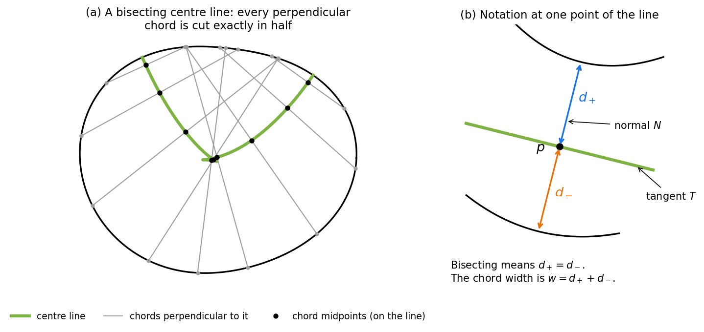
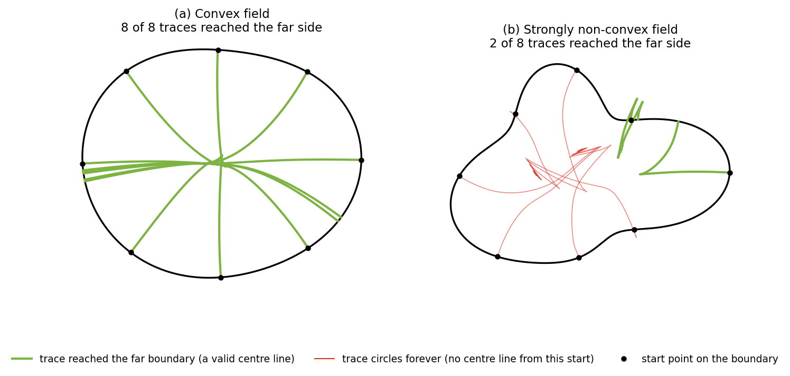
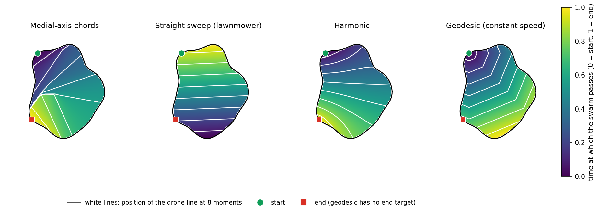
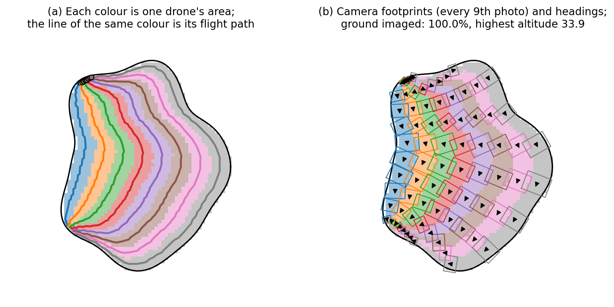

# Planning a Drone Swarm Sweep over a Field of Any Shape

**Team Asclepius, NIDAR Rescueswarm.** Technical report, October 2026.

Code: [`swarm_lab/`](../swarm_lab) · Interactive demo: <https://avinashistoocool.github.io/asclepius/> · Figures: [`figures.py`](figures.py) · Equation checks: [`verify_derivations.py`](verify_derivations.py) · Tables: [`results.py`](results.py)

---

## Summary

A line of drones flies over a field and takes photos of it with cameras that point down. Each drone can fly higher to see a wider strip of ground. Our objective is a photo of each point of the field, at altitudes that are as low as possible.

First, we tried to find one **centre line** through the field with this property: at each position of the drones, the line cuts their row exactly in half. We wrote this as a calculus-of-variations problem (a *Lagrangian*) and derived its equations. We found three results:

1. The equations become a single direction field. When you select the start point on the boundary, the centre line is fixed.
2. In convex fields, this method always operates correctly.
3. In strongly non-convex fields, it usually fails: the traced line turns in circles and never gets to the other side. This is the reason for the message *"No validated numerical trajectory was found"* from our first solver.

Thus, we relaxed the problem. We do not use a single centre line. We describe the sweep with a **time map**: for each point of the field, the time at which the drone line goes over it. We compare four time maps. One of them, the *harmonic* map, comes from the minimisation of an energy. On all fields that we tested, it needed the lowest altitude. Finally, we divide the field between the drones and set the altitudes so that the photos include the full field (100% coverage, guaranteed).

---

## 1. The problem

- **Field.** A region $\Omega$ in the plane, with a closed curve as its boundary. In the code, it is a polygon on a 600 × 600 canvas. All distances are in canvas units.
- **Swarm.** $N$ drones that fly side by side as a flexible line. The line can bend. It can also split into groups to go around an obstacle, and join again later.
- **Camera.** Each drone has a downward (*nadir*) camera with horizontal and vertical fields of view HFOV and VFOV. At altitude $h$, the photo shows a rectangle that is $2h\tan(\mathrm{HFOV}/2)$ wide and $2h\tan(\mathrm{VFOV}/2)$ long. The centre of the rectangle is below the drone, and the rectangle turns with the direction of travel.
- **Objective.** Each point of the field is in one or more photos. Keep the highest altitude low and the paths short. Give the drones similar quantities of work.

This is a *coverage path planning* problem [Choset 2001; Galceran & Carreras 2013; Cabreira et al. 2019]. Most current methods sweep with straight passes that go back and forth [Choset & Pignon 1998]. Other methods divide the field into regions, one for each robot [Cortés et al. 2004]. Our case is different for two reasons: the drones fly together as a single line, and each drone selects its own altitude.

---

## 2. First idea: a centre line that cuts each chord in half

### 2.1 The objective of the search

Think of the drones as a straight row (a **chord** of the field) that moves forward. The row is always perpendicular to a smooth curve $p(s)$, and its centre is on this curve. Then $p(s)$ is the path of the middle drone, and the row has the same length on the two sides.



**Figure 1.** (a) A centre line (green) through a convex field. Each grey chord is perpendicular to the line, and its midpoint (black dot) is on the line. (b) The quantities at one point: $T$ is the direction of the line, and $N$ is the perpendicular direction. $d_+$ and $d_-$ are the distances to the boundary on the two sides.

**Notation.** At a point $p$ on the line:

| Symbol | Meaning |
| --- | --- |
| $s$ | distance along the line |
| $T$, $N$ | unit direction of the line and unit perpendicular |
| $\theta$ | angle of $N$ |
| $d_+$, $d_-$ | distance from $p$ to the boundary along $+N$ and $-N$ (the first wall that the ray touches) |
| $w = d_+ + d_-$ | chord width (the length of the drone row) |
| $e = \tfrac12(d_+ - d_-)$ | distance from the midpoint of the chord to $p$ (zero when the line bisects the chord) |
| $\kappa$ | curvature of the line: the rate at which $T$ turns for each unit of length |

**The requirement** is $e = 0$ at all points along the line, that is, $d_+ = d_-$.

### 2.2 Why this requirement is correct: the formula for the swept area

When the row moves a short distance $\mathrm ds$ along the line, it sweeps a thin strip. A drone at signed offset $r$ from the centre moves $(1-\kappa r)\,\mathrm ds$, because drones on the inner side of a bend move less. The sum over the row is:

$$
\frac{\mathrm dA}{\mathrm ds} = \int_{-d_-}^{d_+} (1-\kappa r)\,\mathrm dr = w\,(1 - \kappa e). \tag{1}
$$

- When $e = 0$, the swept area is exactly $\int w\,\mathrm ds$, with no correction for curvature. This is the reason for a bisecting line.
- The row moves forward at all points only if no drone moves backwards, that is,
  $$\kappa\,d_+ < 1 \quad\text{and}\quad -\kappa\,d_- < 1. \tag{2}$$
  This means: in a bend, the inner end of the row must not go past the centre of the bend. If (2) is not true, adjacent chords cross and the row **folds** over itself.

### 2.3 The Lagrangian

To find the *best* centre line, we minimise a cost $\int f\,\mathrm ds$ along it. Here, $f$ can be a function of the position $p$ and the direction $\theta$. A natural selection is $f = w$, the chord width. By (1), it is equal to the swept area. In calculus-of-variations form, the Lagrangian is

$$
\mathcal L = f(p,\theta)\,|p'| . \tag{3}
$$

With the factor $|p'|$, the cost does not change with the speed along the line. The Euler–Lagrange equation of (3) [Gelfand & Fomin 1963] becomes one equation for the curvature:

$$
\kappa\,\big(f + f_{\theta\theta}\big) = \partial_N f - \partial_T f_\theta. \tag{4}
$$

Here, $f_\theta$ and $f_{\theta\theta}$ are derivatives with respect to the direction. $\partial_N$ and $\partial_T$ are derivatives along $N$ and $T$.

- If $f$ is not a function of the direction, (4) becomes $\kappa f = \partial_N f$. The line bends towards regions with a lower cost, as light bends in glass.
- The term $f + f_{\theta\theta}$ is the *stiffness* of the line. If it becomes negative, the equation has no smooth solution and the line gets corners. The same quantity occurs in the theory of crystal shapes [Taylor 1978; Gurtin 1993].

Equation (4) needs the derivatives of the wall distances $d_\pm$. If $p$ moves or the chord turns, the point where the chord touches the wall changes. If $\nu$ is the outward normal of the wall at this point, then

$$
\nabla_p d = -\frac{\nu}{\nu\cdot n}, \qquad \frac{\partial d}{\partial \alpha} = -\,d\,\frac{\nu\cdot n_\perp}{\nu\cdot n}, \tag{5}
$$

where $n$ is the chord direction, $\alpha$ its angle, and $n_\perp$ the chord direction turned by 90°. The two expressions become infinite when $\nu\cdot n \to 0$, that is, when the chord **grazes** the wall. In a non-convex field, the chord then jumps to a different part of the wall, and $d$ also jumps. This is the root cause of the problem.

### 2.4 The requirement almost fully sets the line

We add the requirement $e=0$ with a Lagrange multiplier $\lambda(s)$. The result is the constrained Lagrangian

$$
\mathcal L_\lambda = \big(f + \lambda\,e\big)\,|p'|. \tag{6}
$$

But examine the requirement. $e = 0$ contains only the position $p$ and the direction $\theta$. It does not contain the change of the direction. Thus, **at each point, $e=0$ gives the direction of the line.** It defines a direction field, and the centre line must follow it. The only free selection is the boundary point $c$ where the line starts. Thus, the minimisation of the cost is a search in one variable:

$$
\min_{c\ \text{on the boundary}} \ \int_{\text{line starting at } c} f\,\mathrm ds. \tag{7}
$$

**Existence of a valid direction.** A turn of the chord by 180° swaps its two ends, thus $e$ changes sign. Between these two positions, $e$ must be zero (intermediate value theorem). Thus, a bisecting direction exists at $p$ if $d_\pm$ change continuously when the chord turns. A convex field guarantees this condition. In a non-convex field, the jumps from §2.3 can go over zero (no valid direction). They can also cross zero two or more times (two or more valid directions, thus the line can branch).

### 2.5 Why our first solver failed

The first implementation is not in the repository now (refer to the git history). It used a smooth spline for the line. Least squares adjusted the spline until $e \approx 0$ at many sample points, with the two ends fixed on the boundary. On most non-trivial fields, it stopped with messages such as

```
Endpoint residual 0.007304; midpoint residual 3.6480.
```

This message means that the chord midpoints were still about 3.6 units away from the line. The analysis above gives the reasons:

1. **The equations are not smooth.** $d_\pm$ jump when the chord changes wall segments, but least squares needs smooth equations.
2. **Too many conditions.** By §2.4, the start point sets the line. If you also fix *the two* ends, there is one condition too many. Thus, in general, there is no solution.
3. **The ends are degenerate.** At the boundary, the chord length decreases to zero, and the equations lose information.
4. **Sometimes no line exists** (§2.4 and §3).

---

## 3. Direct trace of the centre line

### 3.1 Follow the two chord ends, not the midpoint

We do not move the midpoint and cast rays to the walls. We move the **two ends of the chord along the boundary**. Let the boundary be the curve $\gamma(u)$. Put one chord end at $a = \gamma(u)$ and the other at $b = \gamma(v)$. The midpoint is $m = (a+b)/2$ and the chord vector is $q = b - a$.

The chord must stay perpendicular to the path of its midpoint. Because $m' = \tfrac12(\gamma'(u)\,u' + \gamma'(v)\,v')$, this condition is

$$
q\cdot m' = 0 \quad\Longleftrightarrow\quad (q\cdot\gamma'(u))\,u' + (q\cdot\gamma'(v))\,v' = 0,
$$

thus the two ends must move in this ratio:

$$
(u',\ v') \ \propto\ \big(\,q\cdot\gamma'(v),\ \ -\,q\cdot\gamma'(u)\,\big). \tag{8}
$$

This is an ordinary differential equation for $(u,v)$. It does not need ray casting, and it stays smooth if the boundary is smooth. Shape analysis uses similar constructions with the "midpoint of two boundary points" [Brady & Asada 1984; Leyton 1987].

**Start of the trace.** The two chord ends start at the same boundary point $c$, a chord with zero length. At this point, Equation (8) is degenerate, because the two components are zero. Write $u = c - d$, $v = c + d$, and expand for small $d$. The result is

$$
c' \approx -\,d\,\big(\gamma'\cdot\gamma''\big), \qquad d' \approx |\gamma'|^2, \tag{9}
$$

and this is fully regular. Thus, **exactly one centre line starts from each boundary point**, and it leaves the boundary at a right angle. A start from $c$ changes the problem into a step-by-step integration (an initial-value problem), as (7) shows.

**Chords where the line can stop.** The chord stops when the two terms in (8) are zero. Then the chord is perpendicular to the boundary at **the two** ends. Each smooth convex field has a minimum of two such chords: the longest chord (the diameter) and the chord across the narrowest width.

### 3.2 Results in practice

We integrated (8)–(9) with a fourth-order Runge–Kutta method [Hairer et al. 1993] from 8 start points, with equal spaces between them, on two smooth fields:



**Figure 2.** Centre lines traced from 8 start points (black dots). (a) In a convex field, all 8 traces cross the field and end on the opposite boundary. Each trace is a valid centre line. (b) In a strongly non-convex field, only 2 of the 8 traces get to the far side. The other 6 (red) turn in circles in the field, because the chord rotates and never closes.

**Conclusion.** Bisecting centre lines exist reliably only in convex or almost convex fields. For general fields, we need a different method.

---

## 4. The practical method: a time map

### 4.1 The idea

We do not use a single centre line. We describe the sweep with a **time map** $T(x)$: for each point $x$ of the field, the time ($0 \le T \le 1$) at which the drone line goes over it. At time $t$, the drone line is the curve where $T(x) = t$, a *level line* of the map.

- Each point gets a time. Thus, by construction, the swarm sweeps the full field.
- If the level line breaks into two or more pieces, the swarm splits into groups.
- $N$ drones have equal spaces between them along a level line of length $\ell$. Thus, each drone covers a strip of width $\ell/N$. This width sets its altitude.

The coarea formula [Evans 2010] gives a relation between the time map and the lengths of the drone line:

$$
\int_0^1 \big(\text{length of the drone line at time } t\big)\,\mathrm dt = \int_\Omega |\nabla T|\,\mathrm dx . \tag{10}
$$

Thus, a small $|\nabla T|$ keeps the drone line short, and this keeps the altitudes low. Each of our four planners is one selection of $T$.



**Figure 3.** The four time maps on the same field. The colour shows when the swarm goes over each point (dark = early, yellow = late). The white lines show the position of the drone line at 8 times. Green circle: start; red square: end.

### 4.2 The four planners

**Medial-axis chords.** The *medial axis* is the set of centres of the largest circles that fit in the field [Blum 1967]. We use its longest branch (the *trunk*), and we sweep with the chord perpendicular to it. This planner is the nearest relative of §2. But the medial axis has an equal distance to the two walls. This is **not** the same as a cut of the chord in half. The two agree only where the field is locally mirror-symmetric about the trunk. The average midpoint offset is 0.0 on an ellipse, but 10 to 18 units on a star, a neck, or a random blob. The chords also fold where condition (2) is not true.

**Straight sweep (lawnmower).** $T$ is the position along the longest direction of the field (its principal axis). Thus, the drone line is always straight. It is the continuous version of a back-and-forth survey [Choset & Pignon 1998]. All drones move at the same speed, but the line splits at each dent in the boundary.

**Harmonic.** $T = 0$ at the start and $T = 1$ at the end. Between them, $T$ minimises the energy $\int_\Omega |\nabla T|^2$. This is the smoothest possible change from 0 to 1. The Euler–Lagrange equation of this energy is Laplace's equation:

$$
\Delta T = 0 . \tag{11}
$$

Because of the maximum principle, a harmonic map has no peaks or pits in the field. Thus, the drone line never closes into a loop and never folds back. Robot navigation already uses harmonic maps [Connolly et al. 1990]. The minimisation of $\int|\nabla T|^p$ for other powers $p$ gives a family of related planners. With $p \to 1$, the planner minimises the total length (10). With $p \to \infty$, it minimises the single longest drone line [Aronsson 1967].

**Geodesic (constant speed).** $T$ is the shortest walking distance from the start, around obstacles. This is the minimal value of the Lagrangian $\int|\dot x|\,\mathrm dt$, and it satisfies the eikonal equation [Sethian 1999]

$$
|\nabla T| = \text{constant}, \tag{12}
$$

thus the drone line moves forward at the same speed at all points. Behind corners, the line gets sharp kinks and splits. Measure the walking distance from the *full* boundary: its kinks are exactly the medial axis. This is the "grassfire" model of the medial axis [Blum 1967; Kimia et al. 1995].

### 4.3 Calculation of each map

We rasterise the field to a 200 × 200 grid.

- **Medial axis.** Sample the boundary at each 1 unit, and calculate the Voronoi diagram of the samples. The Voronoi edges in the field are an approximation of the medial axis [Brandt & Algazi 1992]. We remove short side branches that small bumps cause [Ogniewicz & Kübler 1995]. The longest remaining path is the trunk. Its two ends define the start and the end of the sweep for all planners.
- **Harmonic.** Solve the standard 5-point discrete Laplace equation with a sparse direct solver [Virtanen et al. 2020].
- **Geodesic.** Shortest paths on the grid by fast marching [Sethian 1996], with the implementation in scikit-image [van der Walt et al. 2014].
- **Positions of the drone line.** The level lines $T = t$ at 90 times, from marching squares [Lorensen & Cline 1987].

---

## 5. From a time map to drones, paths and altitudes



**Figure 4.** The harmonic plan with 8 drones. (a) The division of the field between the drones (colours), and the flight path of each drone. (b) Camera footprints for each 9th photo, with heading arrows. The photos include the full field.

### 5.1 Division of the field between the drones

At each time, measure the drone line from one end to the other, scaled from 0 to 1. Drone $i$ is responsible for the part between $i/N$ and $(i+1)/N$, and it flies along the middle of this part, at $(i + \tfrac12)/N$. We assign each point of the field to the drone whose part went over it. This divides the full field into $N$ areas (Figure 4a). If the line has split into pieces, a drone can have to hop from one piece to a different piece. We count these hops as *transit jumps*.

### 5.2 Selection of the altitudes

At each photo position, we know the position and the heading of the drone. Each point of the area of the drone must be in a photo. A point can be at distance $\alpha$ forward or behind, and $\beta$ to the side, of the nearest photo position. For this point, the minimum altitude of the drone is

$$
h \ \ge\ \max\!\left(\frac{|\beta|}{\tan(\mathrm{HFOV}/2)},\ \frac{|\alpha| - \tfrac12(\text{distance between photos})}{\tan(\mathrm{VFOV}/2)}\right) \tag{13}
$$

For each photo position, we use the largest requirement and add a 10% overlap margin.

### 5.3 Coverage check and gap repair

Then we mark each grid cell that is in a photo. We put photos with small spaces between positions, with the lower of the two adjacent altitudes. Thus, the check is conservative. If the photos do not include a cell, the drone that is responsible for it climbs a small distance near that cell. Then we do the check again.

**Why this procedure always succeeds.** A higher flight only makes footprints larger. Thus, it cannot remove a point from a photo. Each correction only adds coverage, and at a sufficiently high altitude, each footprint covers the full field. In all our experiments, **two rounds** or fewer closed all gaps.

---

## 6. Results

Setup: 12 drones, HFOV 70°, VFOV 55°, 10% overlap. Fields: an ellipse, a five-pointed star, a C-shaped bend, a field with a narrow neck, and a random blob. All four planners photographed **100%** of each field. Altitudes are in canvas units. To get metres, multiply by (field width in metres / 600).

**Table 1. Highest necessary altitude. A lower value is better; bold is the best value in each row.**

| Field | Medial-axis | Lawnmower | Harmonic | Geodesic |
| --- | ---: | ---: | ---: | ---: |
| Ellipse | 21.4 | **21.3** | **21.3** | 24.0 |
| Star | 140.7 | 58.4 | **31.0** | 77.0 |
| C-bend | 31.8 | 55.9 | **15.0** | 23.8 |
| Narrow neck | 93.5 | 84.1 | **21.1** | 159.2 |
| Blob | 27.9 | 28.1 | **24.9** | 79.1 |

**Table 2. Balance of work (smallest drone area ÷ largest drone area; 1 = fully equal). Last column: how frequently medial-axis chords fold over.**

| Field | Medial-axis | Lawnmower | Harmonic | Geodesic | Medial-axis folds |
| --- | ---: | ---: | ---: | ---: | ---: |
| Ellipse | **0.94** | 0.81 | 0.79 | 0.86 | 0% |
| Star | 0.12 | 0.80 | 0.41 | **0.81** | 23% |
| C-bend | 0.64 | **0.73** | 0.48 | **0.73** | 0% |
| Narrow neck | 0.16 | **0.85** | 0.32 | **0.85** | 42% |
| Blob | 0.16 | **0.87** | 0.39 | 0.84 | 52% |

**Results from the tables:**

- **Harmonic needs the lowest altitude on all fields.** It minimises an energy that penalises long, stretched drone lines (equation 10), and its line never folds. The disadvantage is a workload that is not equal. The line comes close together in narrow parts and stretches in wide parts. Thus, some drones cover much more ground than other drones.
- **Lawnmower and geodesic give the most equal division of work,** because their lines move uniformly. But they split around dents, and the geodesic line needs a high altitude where it kinks (159 at the neck).
- **Medial-axis chords operate well only on simple, tube-like fields.** On other fields, the chords fold (Table 2) and do not bisect.

**Recommendation:** Use the harmonic plan when altitude is the primary limit (camera resolution, regulations). Use lawnmower or geodesic when battery and balance of work are more important.

The calculation of all four plans takes 3 to 6 s in Python and 0.8 to 2.3 s in the browser demo.

---

## 7. Checks of the mathematics

[`verify_derivations.py`](verify_derivations.py) checks each equation above numerically:

| Check | Equation | Error found |
| --- | --- | --- |
| Wall-distance derivative w.r.t. position, 200 random chords in an ellipse | (5) | $4\times10^{-8}$ |
| Wall-distance derivative w.r.t. chord angle | (5) | $8\times10^{-8}$ |
| The Euler–Lagrange equation splits as stated (the part along the line is automatically true) | (4) | $3\times10^{-9}$ |
| Traced chord stays perpendicular to the motion of its midpoint | (8) | $8\times10^{-15}$ |
| Harmonic map satisfies the discrete Laplace equation | (11) | $3\times10^{-15}$ |
| Harmonic map has the lowest energy (small changes only increase it) | (11) | confirmed |
| Geodesic map moves at constant speed | (12) | confirmed |

The test suite [`swarm_lab/test_medial.py`](../swarm_lab/test_medial.py) also makes sure that each planner gives each drone an area and photographs 100% of the field.

---

## 8. Possible next steps for the equations

1. **Find the best exact centre line where one exists.** Trace (8)–(9) from many start points. Keep the traces that get to the far side, and select the start with the lowest cost (7). Make sure that each chord touches the *nearest* wall, because in non-convex fields the traced chord can go behind a bump. The chords that are perpendicular to the boundary at the two ends (§3.1) are good start points for the search.
2. **Solve the curvature equation (4) as a boundary-value problem** if you want an optimal line without the exact bisection requirement. Applicable solvers include collocation [Kierzenka & Shampine 2001], available as `scipy.integrate.solve_bvp`, and multiple shooting [Ascher et al. 1995]. Start from an easy shape, for example an ellipse. Change it gradually into the real field, and solve again at each step (numerical continuation [Allgower & Georg 2003]). Monitor the stiffness $f + f_{\theta\theta}$. Where it becomes negative, the line will try to make a corner.
3. **Smooth the wall jumps.** Replace "nearest wall" with a soft minimum over all walls, and make it sharper gradually. Alternatively, write the full problem as an optimisation with an interior-point solver [Wächter & Biegler 2006] through CasADi [Andersson et al. 2019]. Pontryagin's maximum principle [Pontryagin et al. 1962; Bryson & Ho 1975] gives the same equations as (6), and it also includes the turn limits of the drones.
4. **Minimise the worst altitude directly.** The harmonic map minimises an *average*. To minimise the *longest* drone line, minimise $\int|\nabla T|^p$ with increasing $p$ (§4.2) [Aronsson 1967; Chambers & Letscher 2009].
5. **Balance the workload of the harmonic plan.** Solve $\nabla\cdot(a(x)\nabla T)=0$, with a weight $a(x)$ that makes the speed of the line more equal. This planner is between the harmonic and geodesic planners.
6. **Find the exact minimum altitude.** A higher altitude never decreases coverage (§5.3). Thus, bisection can find the lowest uniform altitude scale that gives full coverage.
7. **Real flight.** Add limits for the turn rate and the climb rate. Follow the terrain from an elevation model, and convert to GPS coordinates for the autopilot.

---

## 9. Limitations

- Exact bisecting centre lines exist only in convex or almost convex fields (§3.2). Thus, the time-map method is necessary, not only convenient.
- We calculate the medial axis from boundary samples. The quantity of pruning of side branches has an effect on the medial-axis planner, and on the start and end points of all planners.
- Coverage is guaranteed on a 200 × 200 grid. The method does not resolve features that are smaller than one cell (3 units).
- The model does not include battery, wind, and flight dynamics.
- The browser demo smooths the medial trunk differently from the Python version, and it uses grid Dijkstra, not fast marching. Its values are near the Python results, but not the same.

---

## 10. How to reproduce this report

```powershell
py -m pip install -r swarm_lab/requirements.txt matplotlib
py paper/verify_derivations.py             # Section 7
py paper/figures.py                        # Figures 1-4
py paper/results.py                        # Tables 1-2
cd swarm_lab; py -m unittest test_medial   # coverage tests
```

---

## References

- Allgower, E. L., & Georg, K. (2003). *Introduction to Numerical Continuation Methods*. SIAM.
- Andersson, J. A. E., Gillis, J., Horn, G., Rawlings, J. B., & Diehl, M. (2019). CasADi: a software framework for nonlinear optimization and optimal control. *Mathematical Programming Computation*, 11(1), 1–36.
- Aronsson, G. (1967). Extension of functions satisfying Lipschitz conditions. *Arkiv för Matematik*, 6, 551–561.
- Ascher, U. M., Mattheij, R. M. M., & Russell, R. D. (1995). *Numerical Solution of Boundary Value Problems for Ordinary Differential Equations*. SIAM.
- Blum, H. (1967). A transformation for extracting new descriptors of shape. In W. Wathen-Dunn (Ed.), *Models for the Perception of Speech and Visual Form* (pp. 362–380). MIT Press.
- Brady, M., & Asada, H. (1984). Smoothed local symmetries and their implementation. *The International Journal of Robotics Research*, 3(3), 36–61.
- Brandt, J. W., & Algazi, V. R. (1992). Continuous skeleton computation by Voronoi diagram. *CVGIP: Image Understanding*, 55(3), 329–338.
- Bryson, A. E., & Ho, Y.-C. (1975). *Applied Optimal Control*. Hemisphere.
- Cabreira, T. M., Brisolara, L. B., & Ferreira Jr., P. R. (2019). Survey on coverage path planning with unmanned aerial vehicles. *Drones*, 3(1), 4.
- Chambers, E. W., & Letscher, D. (2009). On the height of a homotopy. *Proceedings of the 21st Canadian Conference on Computational Geometry*, 103–106.
- Choset, H. (2001). Coverage for robotics: a survey of recent results. *Annals of Mathematics and Artificial Intelligence*, 31, 113–126.
- Choset, H., & Pignon, P. (1998). Coverage path planning: the boustrophedon cellular decomposition. In *Field and Service Robotics* (pp. 203–209). Springer.
- Connolly, C. I., Burns, J. B., & Weiss, R. (1990). Path planning using Laplace's equation. *Proceedings of the IEEE International Conference on Robotics and Automation*, 2102–2106.
- Cortés, J., Martínez, S., Karataş, T., & Bullo, F. (2004). Coverage control for mobile sensing networks. *IEEE Transactions on Robotics and Automation*, 20(2), 243–255.
- Evans, L. C. (2010). *Partial Differential Equations* (2nd ed.). American Mathematical Society.
- Galceran, E., & Carreras, M. (2013). A survey on coverage path planning for robotics. *Robotics and Autonomous Systems*, 61(12), 1258–1276.
- Gelfand, I. M., & Fomin, S. V. (1963). *Calculus of Variations*. Prentice-Hall.
- Gurtin, M. E. (1993). *Thermomechanics of Evolving Phase Boundaries in the Plane*. Oxford University Press.
- Hairer, E., Nørsett, S. P., & Wanner, G. (1993). *Solving Ordinary Differential Equations I: Nonstiff Problems* (2nd ed.). Springer.
- Kierzenka, J., & Shampine, L. F. (2001). A BVP solver based on residual control and the MATLAB PSE. *ACM Transactions on Mathematical Software*, 27(3), 299–316.
- Kimia, B. B., Tannenbaum, A. R., & Zucker, S. W. (1995). Shapes, shocks, and deformations I. *International Journal of Computer Vision*, 15, 189–224.
- Leyton, M. (1987). Symmetry-curvature duality. *Computer Vision, Graphics, and Image Processing*, 38(3), 327–341.
- Lorensen, W. E., & Cline, H. E. (1987). Marching cubes: a high resolution 3D surface construction algorithm. *ACM SIGGRAPH Computer Graphics*, 21(4), 163–169.
- Ogniewicz, R. L., & Kübler, O. (1995). Hierarchic Voronoi skeletons. *Pattern Recognition*, 28(3), 343–359.
- Pontryagin, L. S., Boltyanskii, V. G., Gamkrelidze, R. V., & Mishchenko, E. F. (1962). *The Mathematical Theory of Optimal Processes*. Interscience.
- Sethian, J. A. (1996). A fast marching level set method for monotonically advancing fronts. *Proceedings of the National Academy of Sciences*, 93(4), 1591–1595.
- Sethian, J. A. (1999). *Level Set Methods and Fast Marching Methods* (2nd ed.). Cambridge University Press.
- Taylor, J. E. (1978). Crystalline variational problems. *Bulletin of the American Mathematical Society*, 84(4), 568–588.
- van der Walt, S., et al. (2014). scikit-image: image processing in Python. *PeerJ*, 2, e453.
- Virtanen, P., et al. (2020). SciPy 1.0: fundamental algorithms for scientific computing in Python. *Nature Methods*, 17, 261–272.
- Wächter, A., & Biegler, L. T. (2006). On the implementation of an interior-point filter line-search algorithm for large-scale nonlinear programming. *Mathematical Programming*, 106(1), 25–57.
